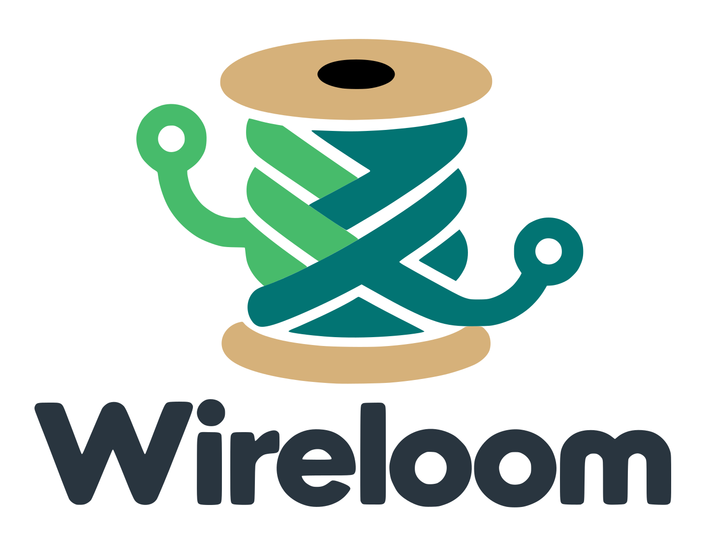
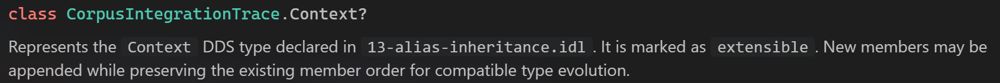
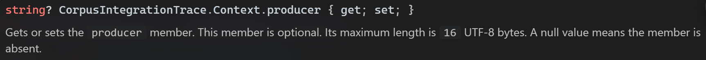

# Wireloom

<!-- markdownlint-disable-next-line MD033 -->


[](https://github.com/eNeRGy164/wireloom/actions/workflows/quality.yml)
[](https://coveralls.io/github/eNeRGy164/wireloom?branch=main)
[](https://www.nuget.org/packages/Wireloom.Dds.Generator)
[](https://scorecard.dev/viewer/?uri=github.com/eNeRGy164/wireloom)

**Replace `rtiddsgen` in your C# build. Keep RTI Connext DDS.**

Wireloom brings IDL generation into the .NET compiler for **.NET 8 and higher**.
It generates your C# data types and RTI type-specific support from IDL during a normal build, with
rich IntelliSense documentation, modern C#, and a small NuGet package. For
supported IDL contracts, it replaces the complete C# generation step:
preprocessing, parsing, validation, and emission.

The RTI Connext DDS runtime still provides serialization and DDS communication.
Your application continues to use RTI's runtime, APIs, and configuration.

## Why Wireloom?

- **Keep build images and developer machines lean.** Restore a small NuGet
  generator package and use the .NET build to create C# from IDL. Generation
  needs no separate RTI generator installation, Java toolchain, or external
  preprocessor.
- **Understand your contracts without leaving the editor.** Generated XML
  documentation explains DDS keys, optional presence, string and collection
  bounds, defaults, member IDs, and union branch selection. Remarks, examples,
  exception documentation, and RTI API links put the contract beside the code
  you are writing.
- **Keep generated C# clean and readable.** It compiles with zero warnings. In
  the reported Qodana scans, Wireloom had 1,290 raw findings versus 8,544 for
  retained RTI output; after review, six Wireloom warnings remained. This keeps
  generated-code noise low so issues in your code stand out. See the
  [quality report](docs/corpus/csharp-quality.md) for scope and results.
- **Make generation setup repeatable.** One `PackageReference` and one
  `DdsIdl` item connect IDL to the build. Includes and defines are declarative
  MSBuild settings carried with the project. A clean restore and build use that
  configuration without custom `Exec` targets, generator installation paths,
  or generation-tool environment variables.
- **Work directly from IDL.** Roslyn exposes generated documents in the IDE;
  diagnostics point back to the IDL or included file. Root and include changes
  are tracked as compiler inputs, so regeneration belongs to the normal build.
- **Extend your types without editing generated files.** Generated data classes
  are `partial`, so application helpers can live in separate, maintained C#
  files and survive regeneration.

Wireloom fits C# projects whose IDL shapes are covered and whose RTI runtime
version is qualified, especially when build and IDE integration matters and
best-effort support is acceptable. Keep RTI generation for shapes or options
outside that coverage, or when your requirements call for a generation tool
covered by your RTI support agreement. See the
[support and compatibility policy](docs/guides/support-and-compatibility.md).

RTI's generator serves multiple languages, platforms, and release toolchains.
Wireloom focuses on the C# developer experience within that ecosystem. The
benefit is a smaller generation setup and C# output that fits naturally into
today's .NET tooling.

### See the DDS contract in IntelliSense

Hover over a generated type to see where it was declared and how its
extensibility affects compatible type evolution:



Hover over a member to see the details that matter when assigning values.
Here, `producer` is optional, its bound is **16 UTF-8 bytes**, and `null` means
the member is absent:



### Less tooling to install

Generate C# from IDL using the SDK already building your application and a
small generator package. The locally packed Wireloom 0.4.0 package measured
**175,113 bytes (about 175 kB)**. The RTI runtime remains a NuGet dependency
in either workflow; the package measurement covers generation tooling.

The footprint matters in practice: provisioning RTI generation tooling added
about **2 GB** to the C# Docker build images in the pipeline that motivated
Wireloom. That is an observation from the original setup, whose selected tools
determined its size. See the [project background](docs/architecture/arc42/01-introduction-and-goals.md)
for the other requirements that shaped Wireloom, and the
[package-size evidence](docs/corpus/csharp-quality.md#package-size) for the local
package measurement.

| Generation concern | External `rtiddsgen` workflow                                                                | Wireloom workflow                                          |
| :----------------- | :------------------------------------------------------------------------------------------- | :--------------------------------------------------------- |
| Tool provisioning  | Install or provide the RTI code generator and its Java tooling                               | Restore one small NuGet generator package                  |
| IDL preprocessing  | Configure the external C/C++ preprocessor when needed                                        | Managed preprocessing inside the generator                 |
| Build integration  | Invoke the generator and manage tool paths, arguments, outputs, and generated compile inputs | Declare the package and IDL roots in the project           |
| Generated files    | Generate physical C# files and arrange their inclusion in the build                          | Roslyn generated documents; optional export for inspection |
| Error navigation   | Surface external-tool output through your build integration                                  | Source-located compiler diagnostics for IDL and includes   |

RTI's [C# getting-started guide](https://community.rti.com/static/documentation/connext-dds/current/doc/manuals/connext_dds_professional/getting_started_guide/csharp/intro_pubsub_csharp.html)
describes generator invocation, path setup, and external preprocessing. Existing
projects may already automate these steps; Wireloom makes them part of the
package's compiler integration.

## Get started

Add the generator and RTI runtime to the project that owns your DDS contracts.
The runtime reference is explicit because your application controls its runtime
version and configuration.

For this first example, create a console application:

```powershell
dotnet new console --name WireloomQuickstart --framework net10.0
cd WireloomQuickstart
```

Replace `WireloomQuickstart.csproj` with:

```xml
<Project Sdk="Microsoft.NET.Sdk">
  <PropertyGroup>
    <OutputType>Exe</OutputType>
    <TargetFramework>net10.0</TargetFramework>
    <LangVersion>latest</LangVersion>
    <ImplicitUsings>enable</ImplicitUsings>
    <Nullable>enable</Nullable>
  </PropertyGroup>

  <ItemGroup>
    <PackageReference Include="Rti.ConnextDds" Version="7.7.0" />
    <PackageReference Include="Wireloom.Dds.Generator" Version="0.4.0" PrivateAssets="all" />
  </ItemGroup>

  <ItemGroup>
    <DdsIdl Include="Contracts\Telemetry.idl" />
  </ItemGroup>
</Project>
```

Create a `Contracts` directory and save this as `Contracts/Telemetry.idl`:

```idl
module Telemetry {
  struct Sample {
    long id;
    string<64> label;
    sequence<float, 8> values;
  };
};
```

The `DdsIdl` item identifies a generation root. Files included by that root are
tracked as inputs but are not generated as independent roots. For include
directories and preprocessing options, see the [package usage guide](src/Wireloom.Dds.Generator/README.md).

Replace `Program.cs` with code that uses the generated API:

```csharp
var sample = new Telemetry.Sample
{
    id = 42,
    label = "temperature"
};

sample.values.Add(20.5F);
using var serializer = Telemetry.SampleSupport.Instance.CreateSerializer();
```

```powershell
dotnet build
```

A successful build confirms that the generator ran, emitted the expected
`Telemetry.Sample` and `Telemetry.SampleSupport` APIs, and that the compiler
accepted them against the referenced RTI runtime.

Continue with the [Hello World publisher/subscriber tutorial](docs/guides/hello-world.md)
to run two applications and exchange samples. It follows RTI's familiar C#
getting-started flow, with generation supplied by the Wireloom package.

### Follow an IDL diagnostic into generated C\#

If an IDL declaration uses an annotation that Wireloom recognizes but does not
support, the build reports the problem at the IDL source and withholds the
generated type. For example, this declaration uses unsupported `@position`:

```idl
module Sample {
  @position(1) struct Value { long value; };
};
```

The build reports `DDSG0102` for the unsupported annotation and a contextual
`DDSG0001` error because generation cannot continue. Remove the unsupported
annotation, then build again:

```idl
module Sample {
  struct Value { long value; };
};
```

The generated `Sample.Value` can then be used from application code:

```csharp
var value = new Sample.Value { value = 42 };
```

This example shows the IDL-to-diagnostic-to-C# workflow; it does not claim a
measured productivity or build-time improvement. See the [diagnostic
reference](src/Wireloom.Dds.Generator/README.md#diagnostics) for the complete
diagnostic catalog.

Generated source appears in the IDE as Roslyn generated documents. To write it
under `obj` for inspection, add:

```xml
<PropertyGroup>
  <EmitCompilerGeneratedFiles>true</EmitCompilerGeneratedFiles>
  <CompilerGeneratedFilesOutputPath>$(BaseIntermediateOutputPath)generated</CompilerGeneratedFilesOutputPath>
</PropertyGroup>
```

## Additional advantages over RTI C\#

These less common cases are additional Wireloom advantages over the retained
RTI C# output. They follow the quick start so readers see the everyday
workflow first; each claim links to its evidence and states its limits.

### Wide-character union support

Wireloom accepts the `wchar` discriminator case that the retained RTI
generator rejects before C# emission
([C113](docs/corpus/idl/features/07-union-wchar-label.idl)). This is a
generation extension; consult the separate wire evidence before adopting it.

### Recursive-array support on first use

Wireloom initializes self-referencing optional fixed-array support through
ordinary `Support.Instance` access and type-support discovery, without application
bootstrapping. With RTI 7.7.0, the retained rtiddsgen 4.7.0 C# output instead
requires plugin initialization first. Fresh-process tests check startup and
serialization of absent, present, and nested arrays; see the
[reproducible comparison](tests/Wireloom.Dds.Generator.RuntimeContracts/README.md#recursive-support-startup).
Public recursive DynamicType and default recursive TypeObject discovery remain
RTI limitations.

### Compilable generated C\#

The retained corpus also includes cases where RTI accepts an IDL input but its
generated C# does not compile, while Wireloom generates compilable C# for the
same data-type cases. The [catalog](docs/corpus/RTI-CODEGEN-DEFECTS.md)
lists findings by RTI release and case, with evidence and scope limits.

## Support and compatibility

Compatibility is tracked per IDL feature. Wireloom supports modules, structs,
aliases, enums, unions, constants, collections, arrays, optional aggregate
members, aggregate typedef aliases, and preprocessing.
Unsupported declarations are reported with diagnostics instead of being
silently omitted.

Check the [feature coverage index](docs/corpus/FEATURE-COVERAGE.md) for the
current status of individual IDL shapes. Wireloom selects a generated API
profile from the resolved RTI package: 7.3.1 through 7.6.x use the 7.3.1
profile, while 7.7.0 and later use the 7.7.0 profile. Versions below 7.3.1
produce `DDSG0003`. Only exact RTI 7.3.1 and 7.7.0 LTS versions are
qualification targets; the mapping does not qualify every intervening or later
release. See the [support and compatibility guide](docs/guides/support-and-compatibility.md).

Consumer projects can target **.NET 8 and higher** and must use **C# 12 or
later**. The generator package targets `netstandard2.0` for Roslyn host
compatibility. The repository's default build and corpus/wire verification
projects use .NET 10; that is the maintainer baseline, not the minimum consumer
framework. The [package integration suite](tests/Wireloom.Dds.Generator.PackageIntegration/README.md)
also passes when targeting .NET 8 with C# 12, using the repository's pinned SDK.

Corpus results compare source-generation behavior and generated C# shape. They
do not establish serialization-byte equivalence, live DDS behavior, or C++
interoperability. The separate [wire compatibility matrix](tests/Wireloom.Dds.Generator.WireCompatibility/README.md)
tests fixture values across all nine directed pairings of Wireloom C#,
RTI-generated C#, and RTI C++ peers on exact RTI 7.7.0. Consult its
[workflow reports](https://github.com/eNeRGy164/wireloom/actions/workflows/wire-compatibility.yml)
for executed outcomes, known failures, and peer adaptations.

Before replacing existing generated code, check your IDL shapes and public API
usage against that evidence. Direct arrays of sequences flatten by default;
use a sequence typedef or explicitly select the
[IDL sequence-array mapping](docs/guides/configuration.md#choose-the-sequence-array-mapping)
and validate the application's interoperability requirements. Wireloom is not
yet a universal drop-in replacement for every `rtiddsgen` option or generated
API shape.

Follow the [migration guide](docs/migration/rtiddsgen-to-wireloom.md) to
inventory options, compare generated APIs, and validate runtime and wire
behavior before switching a consumer project. See the
[support and compatibility policy](docs/guides/support-and-compatibility.md)
for Wireloom's support boundary, exact-version qualification, stability
expectations, and guidance on choosing a generation path.

## Testing and quality

The [Quality workflow](.github/workflows/quality.yml) checks multiple parts of
the generator: unit tests and tracked code coverage, bounded FsCheck fuzzing of
the public compiler and Roslyn adapter, corpus compliance for RTI 7.3.1 and
7.7.0, runtime contracts, packed-package consumers, and a Qodana static
analysis scan. The fuzz gate runs 10,000 generated inputs per property in CI;
see the [fuzzing guide](docs/testing/fuzzing.md) for its scope and limits.

Two deeper checks run separately. The manual
[mutation-testing workflow](.github/workflows/mutation.yml) uses Stryker to
change generator code and checks whether the test suite detects those changes;
it is advisory, not a check on every pull request. Licensed
[DDS wire-compatibility tests](tests/Wireloom.Dds.Generator.WireCompatibility/README.md)
exercise live exchanges between Wireloom and RTI C# and C++ peers. See
[contributor quality evidence](CONTRIBUTING.md#quality-evidence) for the
verification expectations and reports.

## Documentation

| If you want to...                                                             | Read...                                                                                                                                          |
| :---------------------------------------------------------------------------- | :----------------------------------------------------------------------------------------------------------------------------------------------- |
| Build and run your first publisher and subscriber                             | [Hello World tutorial](docs/guides/hello-world.md)                                                                                               |
| Add IDL generation to a project or configure includes and preprocessing       | [Package usage and configuration](src/Wireloom.Dds.Generator/README.md)                                                                          |
| Look up every generation setting, its scope, and its effect                   | [Configuration reference](docs/guides/configuration.md)                                                                                          |
| Check supported IDL shapes and preprocessing behavior                         | [Feature coverage](docs/corpus/FEATURE-COVERAGE.md) · [Preprocessor feature matrix](docs/PREPROCESSOR-FEATURES.md)                               |
| Understand generated member types, mutation, and value semantics              | [Generated value semantics](docs/guides/generated-value-semantics.md)                                                                            |
| Migrate from `rtiddsgen` and compare generated APIs                           | [Migration guide](docs/migration/rtiddsgen-to-wireloom.md)                                                                                       |
| Check runtime and DDS wire compatibility evidence                             | [Wire compatibility matrix](tests/Wireloom.Dds.Generator.WireCompatibility/README.md)                                                            |
| Compare generated C# quality and observed RTI code-generation defects         | [Generated C# quality comparison](docs/corpus/csharp-quality.md) · [RTI code-generation defect catalog](docs/corpus/RTI-CODEGEN-DEFECTS.md)      |
| Understand version qualification, support boundaries, and generation-path fit | [Support and compatibility policy](docs/guides/support-and-compatibility.md)                                                                     |
| Learn the architecture or incremental-generation baseline                     | [Architecture overview](docs/architecture/arc42/index.md) · [Incremental generator baseline](docs/performance/incremental-generator-baseline.md) |
| Contribute code or documentation                                              | [Code style](docs/CODE-STYLE.md) · [Contributing and maintainer guide](CONTRIBUTING.md)                                                          |

## License

Wireloom is licensed under the [MIT License](LICENSE). That license does not
apply to the RTI-generated oracle sources under
[`docs/corpus/<version>/rtiddsgen`](docs/corpus/README.md) or other third-party
materials. Review the [corpus guidance](docs/corpus/README.md) before
redistributing or changing those reference artifacts.
