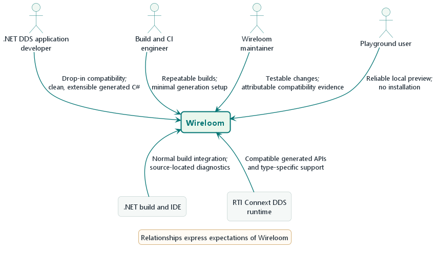

# 3. Context and scope

Wireloom is an independent build-time component between a .NET consumer project
and the generated C# contract consumed by the application. It has no official
relationship with RTI and does not sit in the DDS data path. The RTI runtime
remains responsible for serialization and communication.

## 3.1 Business context

| Neighbor                                  | Direction                 | Exchanged value / data                                                        |
| :---------------------------------------- | :------------------------ | :---------------------------------------------------------------------------- |
| .NET DDS consumer                         | to Wireloom               | `DdsIdl` roots, batch-wide include directories/defines, and runtime reference |
| Wireloom package                          | to consumer build         | Generated C# data types and RTI type-specific support                         |
| Repository compiler host                  | to compiler core          | In-memory `IdlInput` collection and explicit RTI API profile                  |
| Browser Playground visitor                | to Playground client      | IDL text and selected RTI profile; source remains in the browser              |
| Playground client                         | to compiler worker        | Versioned workspace snapshot; receives generated documents and diagnostics    |
| Static host                               | to browser                | Vite client assets and published .NET WebAssembly runtime files               |
| RTI Connext DDS runtime                   | to generated application  | Runtime APIs, serialization, and DDS communication                            |
| RTI Connext DDS 7.7.0 / `rtiddsgen` 4.7.0 | to compatibility evidence | Named oracle output for selected cases; target floor is RTI 7.3.1+            |
| CI and package feeds                      | to/from repository        | Restore, tests, package artifacts, SBOM, and attestations                     |

## 3.2 Technical context

| Interface              | Neighbor                          | Protocol / format                                                | Where documented                                                                                             |
| :--------------------- | :-------------------------------- | :--------------------------------------------------------------- | :----------------------------------------------------------------------------------------------------------- |
| `DdsIdl` MSBuild items | Consumer project                  | MSBuild item metadata and project properties                     | [Configuration guide](../../guides/configuration.md)                                                         |
| `AdditionalFiles`      | Roslyn                            | Compiler input and analyzer configuration                        | [`Wireloom.Dds.Generator.targets`](../../../src/Wireloom.Dds.Generator/build/Wireloom.Dds.Generator.targets) |
| IDL include graph      | Wireloom compiler                 | Connext IDL text and `#include`                                  | [Corpus guide](../../corpus/README.md)                                                                       |
| Generated documents    | Consumer compilation              | C# source                                                        | [Building block view](05-building-block-view.md)                                                             |
| Compiler API           | Repository C# project             | `IdlInput`, profile, documents, and diagnostics                  | [Programmatic compiler guide](../../guides/configuration.md#configure-the-programmatic-compiler)             |
| Playground protocol    | TypeScript client and .NET worker | JSON workspace request/result with request and revision identity | [Playground runtime](06-runtime-view.md#64-browser-playground-compilation)                                   |
| Oracle fixtures        | Corpus compliance tests           | IDL, JSON manifest, retained C#                                  | [Feature coverage](../../corpus/FEATURE-COVERAGE.md)                                                         |

The compiler boundary is an in-memory API. Repository and browser hosts select
an explicit profile and supply source text; the compiler does not discover
MSBuild inputs, resolve an RTI assembly, or read files. The browser Playground
loads the compiler in a dedicated WebAssembly worker. It previews generated
source and diagnostics; it does not compile that source against RTI or perform
DDS communication. The RTI runtime remains responsible for DDS communication.
