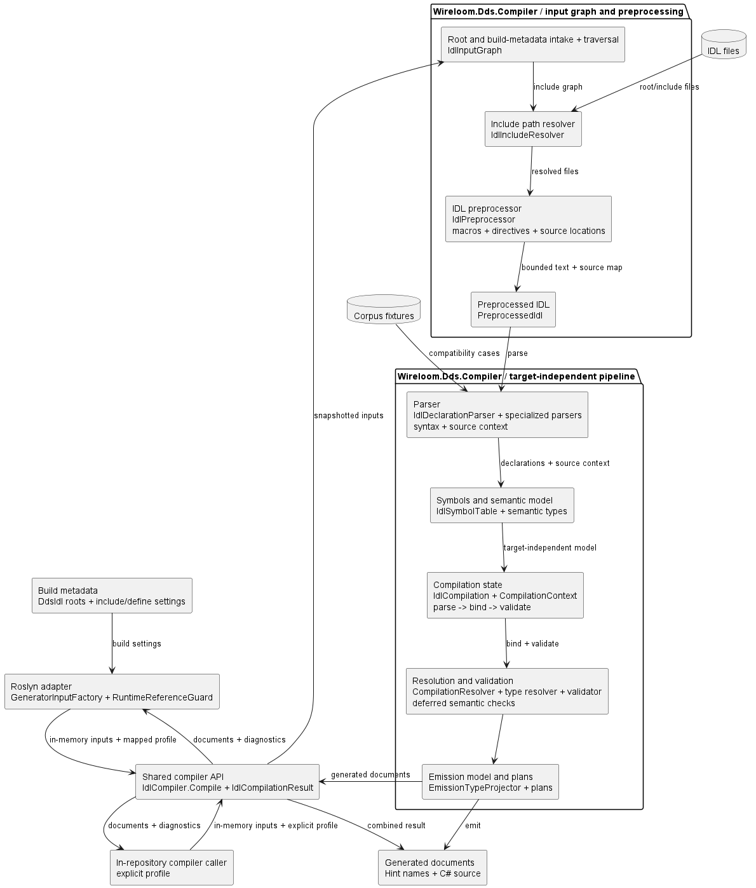
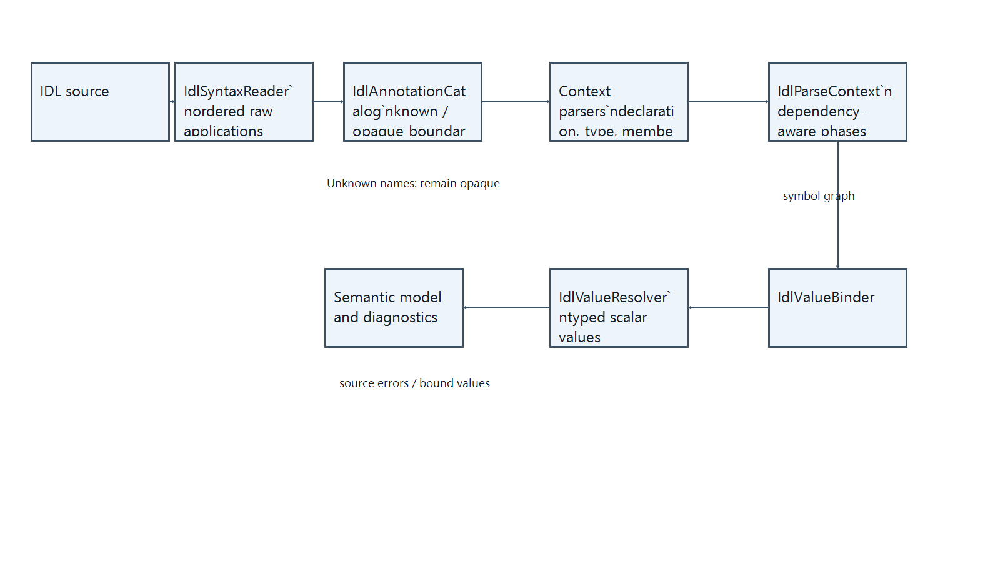

# 5. Building block view

Wireloom separates the Roslyn adapter from the shared compiler project. The
level-1 view shows the package and repository-host boundaries; level 2 shows
compiler ownership and handoffs.

## 5.1 Level 1: White-box overall system

The generator and in-repository callers use the same non-packable compiler
project. The generator package carries the compiler assembly for analyzer
loading; compiler stages are expanded in the level-2 view.

| Building block               | Project                      | Responsibility                                                | Main boundary                                     |
| :--------------------------- | :--------------------------- | :------------------------------------------------------------ | :------------------------------------------------ |
| Roslyn adapter               | `Wireloom.Dds.Generator`     | Discovers build inputs, maps runtime version, reports diagnostics, and adds documents | `Generator`, `GeneratorInputFactory`              |
| Shared compiler API          | `Wireloom.Dds.Compiler`      | Accepts in-memory inputs and explicit profile; returns documents and diagnostics | `IdlCompiler`, `IdlCompilationResult`             |
| Input graph and preprocessor | `Wireloom.Dds.Compiler`      | Resolves supplied roots and includes; applies preprocessing   | `IdlInputGraph`, `IdlPreprocessor`                |
| Front end                    | `Wireloom.Dds.Compiler`      | Parses, binds, and validates IDL                              | `Compiler/FrontEnd`                               |
| Compilation orchestration    | `Wireloom.Dds.Compiler`      | Coordinates compilation and emission handoff                  | `IdlCompilation`, `CompilationContext`            |
| Emission planning and emitters | `Wireloom.Dds.Compiler`     | Chooses generated API shapes and renders C# documents         | `Emission/Model`, planning, emitters, writers     |
| MSBuild targets              | Generator package           | Pass IDL roots and metadata to the Roslyn adapter             | Packed NuGet package                              |
| Corpus and integration tests | Existing test projects      | Verify acceptance, generated API shape, and package loading   | Separate test layers                              |

The public core API is defined in
[`IdlCompiler`](../../../src/Wireloom.Dds.Compiler/Api/IdlCompiler.cs),
[`IdlInput`](../../../src/Wireloom.Dds.Compiler/Api/IdlInput.cs),
[`IdlCompilerProfile`](../../../src/Wireloom.Dds.Compiler/Api/IdlCompilerProfile.cs),
and [`IdlCompilationResult`](../../../src/Wireloom.Dds.Compiler/Api/IdlCompilationResult.cs).
It snapshots inputs, requires a profile on each call, and returns documents and
diagnostics together. Its `netstandard2.0` project has no Roslyn, MSBuild, or
RTI assembly reference. `Wireloom.Dds.Generator` keeps the build-host adapters
and bundles the compiler DLL and XML documentation in the existing analyzer
package.

## 5.2 Level 2: Compiler and preprocessing

| Stage                     | Responsibility                                                                                                                                    | Main implementation                                                                                                              |
| :------------------------ | :------------------------------------------------------------------------------------------------------------------------------------------------ | :------------------------------------------------------------------------------------------------------------------------------- |
| Root intake               | Builds the graph from `DdsIdl` roots, project options, and file-owned mapping and effective-limit settings                                        | [`IdlInputGraph`](../../../src/Wireloom.Dds.Compiler/Compiler/FrontEnd/Preprocessing/IdlInputGraph.cs)                          |
| Include resolution        | Resolves paths while preserving root/include identity                                                                                             | [`IdlIncludeResolver`](../../../src/Wireloom.Dds.Compiler/Compiler/FrontEnd/Preprocessing/IdlIncludeResolver.cs)                |
| Preprocessing             | Applies directives and macros with source mapping; optionally normalizes escaped identifier tokens while composing source origins                  | [`IdlPreprocessor`](../../../src/Wireloom.Dds.Compiler/Compiler/FrontEnd/Preprocessing/IdlPreprocessor.cs), `IdlEscapeCharNormalizer` |
| Parsing                   | Reads ordered annotations, type/declarator syntax, and unresolved value expressions while preserving source locations                             | [`IdlDeclarationParser`](../../../src/Wireloom.Dds.Compiler/Compiler/FrontEnd/Parsing/IdlDeclarationParser.cs), `IdlTypeParser` |
| Semantic model            | Assigns stable symbols and target-independent meaning, including enum identity and typedef annotations                                            | [`IdlSymbolTable`](../../../src/Wireloom.Dds.Compiler/Compiler/FrontEnd/Symbols/IdlSymbolTable.cs)                              |
| Compilation state         | Coordinates parse, bind, and validate                                                                                                             | [`IdlCompilation`](../../../src/Wireloom.Dds.Compiler/Compiler/IdlCompilation.cs)                                               |
| Resolution and validation | Binds constants, enum identities, effective member IDs, deferred bounds, union labels, and typed defaults; reports source-located semantic errors | `IdlTypeBinder`, `IdlValueBinder`, `IdlValueResolver`, `IdlMemberIdBinder`                                                       |
| Specification rules       | Detects keyword, scope, and derived-key violations                                                                                                | `IdlIdentifierValidator`, `IdlSemanticValidator`                                                                                 |
| Validation policy         | Applies the batch strictness to specification findings                                                                                            | `IdlValidationPolicy`                                                                                                            |
| Emission planning         | Projects validated declarations, typed defaults, and union array lifecycle into output plans                                                      | [`EmissionTypeProjector`](../../../src/Wireloom.Dds.Compiler/Compiler/Emission/Planning/EmissionTypeProjector.cs)               |

The front end reads supported annotations through declaration, type-prefix,
member, enum-literal, and union-branch readers. `IdlSyntaxReader` captures
applications in source order with source offsets and balanced raw text.
`IdlAnnotationCatalog` defines built-in parameter kinds, defaults, targets,
positional-argument rules, repeat/conflict metadata, and recognized unsupported
names. It validates known argument shapes while unknown applications remain
opaque. Readers still own context-specific application and compatibility
behavior; the catalog is the shared schema, not a replacement semantic model.
The binder resolves references, constants, member IDs, bounds, union labels, and defaults against the complete symbol graph,
then validates semantics before planning emission.
`IdlParseContext` coordinates these stages; `IdlValueBinder` owns queued
constant, typedef, and member values. `IdlValueResolver` applies typed default
and range rules, and `IdlStringLiteralDecoder` decodes individual literal
tokens before concatenating their values. Parsers retain annotation syntax and
original locations without speculative value evaluation or exception-based
deferral. Structs, unions, and enums share ordered prefix annotation parsing;
extensibility is captured once as a typed kind rather than overwritten text.
Duplicate named argument keys are rejected for known applications during
binding. Catalogued target checks apply to declaration prefixes, typedefs,
members, enum literals, and union branches. The catalog validates repeated
applications and conflicts for each captured target list. Local struct and
union `@autoid` applications and typedef `@default`
applications are retained on their semantic targets; the value binder reads a
typedef default expression only after the target type is resolved. Module
scope records retain module-level `@autoid` and resolve the policy inherited
by nested declarations because member IDs are assigned during declaration
parsing. Public compiler tests exercise mixed built-in order
with interleaved opaque applications across those targets and inspect emitted
API/metadata and diagnostics. The numeric expression dispatcher applies OMG
constant-expression semantics for supported integral, `float`, and `double`
contexts through the existing integral and floating evaluators. Boolean,
character, string, and enum values use their typed literal/name binding rules
rather than a general-purpose expression tree. `long double` and fixed-point
remain unsupported, while new scalar variants can be added to the internal
model without changing the capture/catalog/binding boundaries.
`IdlScalarValue` represents mutually exclusive integer, boolean, character,
floating-point, string, and enumeration values. Character and string values
retain their narrow/wide identity, and enumeration values retain their
declaring type. Constants and defaults use this same representation; an
integer evaluator can consume only an integer value. This replaces nullable
parallel scalar fields whose combinations could lose the original IDL type.
Its semantic model does not depend on the RTI version. The runtime reference
adapter selects an immutable `RtiApiProfile`; compilation orchestration passes
that profile to emission planning. Emitters render plans without comparing
RTI versions. A central result boundary checks duplicate hint names across
generated documents.

Parsers capture identifier spellings, lexical scopes, and original source
locations. `IdlInterfaceIdentifierParser` collects body declarations without
adding types to emission or binding interface references. Its scope facts
distinguish ordinary interfaces from DDS services and operation parameters. Specification rules return typed findings; the validation policy
decides whether to ignore, warn, or fail, and Roslyn presents the resulting
diagnostics. The validation scope index is private to each compilation;
collision checks preserve case-sensitive binding and generated names.

`DdsIdlEnableEscapeChar` enables token-aware normalization after preprocessing.
The normalizer removes one leading underscore from each IDL identifier,
preserves the original source location, and records escaped declaration facts
for keyword validation. The project-wide setting keeps declarations and
references consistent across the shared symbol graph.

This view describes ownership rather than execution order. Build-time flow and
failure paths are in [chapter 6](06-runtime-view.md). Deterministic
preprocessing limits are in
[chapter 8.7](08-crosscutting-concepts.md#87-deterministic-preprocessing-safety).

## 5.3 Level 3: Annotation syntax and value binding

This level describes the source-facing building blocks maintainers change
when adding or correcting built-in annotation behavior.

| Building block        | Responsibility                                                                                                                                                                       | Source                                                                                                                                                                                                                                                                                                                                                                                                               |
| :-------------------- | :----------------------------------------------------------------------------------------------------------------------------------------------------------------------------------- | :------------------------------------------------------------------------------------------------------------------------------------------------------------------------------------------------------------------------------------------------------------------------------------------------------------------------------------------------------------------------------------------------------------------- |
| Syntax reader         | Reads a complete balanced application and preserves ordered raw syntax and offsets                                                                                                   | [`IdlSyntaxReader`](../../../src/Wireloom.Dds.Compiler/Compiler/FrontEnd/Parsing/IdlSyntaxReader.cs)                                                                                                                                                                                                                                                                                                                |
| Built-in catalog      | Defines parameter kinds/defaults, targets, positional rules, repeat/conflict metadata, and support status; validates known argument shapes while leaving unknown arguments opaque    | [`IdlAnnotationCatalog`](../../../src/Wireloom.Dds.Compiler/Compiler/FrontEnd/Parsing/IdlAnnotationCatalog.cs)                                                                                                                                                                                                                                                                                                      |
| Type-prefix reader    | Captures declaration annotations in order and delays unknown warnings until a declaration parser accepts the target                                                                  | [`IdlTypeAnnotationPrefix`](../../../src/Wireloom.Dds.Compiler/Compiler/FrontEnd/Parsing/IdlTypeAnnotationPrefix.cs)                                                                                                                                                                                                                                                                                                |
| Declaration parser    | Coordinates declaration-level annotation handling and top-level parse order                                                                                                          | [`IdlDeclarationParser`](../../../src/Wireloom.Dds.Compiler/Compiler/FrontEnd/Parsing/IdlDeclarationParser.cs)                                                                                                                                                                                                                                                                                                      |
| Module scope model    | Retains module identity and captured scope annotations while the derived member-ID policy is passed to nested declarations                                                           | [`IdlModuleDeclaration`](../../../src/Wireloom.Dds.Compiler/Compiler/FrontEnd/Semantic/IdlDeclaration.cs), [`IdlDeclarationParser`](../../../src/Wireloom.Dds.Compiler/Compiler/FrontEnd/Parsing/IdlDeclarationParser.cs)                                                                                                                                                                                          |
| Member parser         | Applies known annotations in source order, keeps unknown syntax opaque, binds metadata, and defers symbol-dependent values                                                           | [`IdlTypeParser`](../../../src/Wireloom.Dds.Compiler/Compiler/FrontEnd/Parsing/IdlTypeParser.cs), [`IdlMemberAnnotationSyntax`](../../../src/Wireloom.Dds.Compiler/Compiler/FrontEnd/Semantic/IdlMemberAnnotationSyntax.cs)                                                                                                                                                                                        |
| Enum-literal parser   | Reads ordered `@value` and `@default_literal` uses while leaving unknown arguments opaque                                                                                            | [`IdlEnumDeclarationParser`](../../../src/Wireloom.Dds.Compiler/Compiler/FrontEnd/Parsing/IdlEnumDeclarationParser.cs)                                                                                                                                                                                                                                                                                              |
| Union-branch parser   | Reads branch labels, optional annotations, and unknown applications before parsing the branch type                                                                                   | [`IdlUnionParser`](../../../src/Wireloom.Dds.Compiler/Compiler/FrontEnd/Parsing/IdlUnionParser.cs)                                                                                                                                                                                                                                                                                                                  |
| Binding coordinator   | Resolves values in dependency order after the symbol graph is available                                                                                                              | [`IdlParseContext`](../../../src/Wireloom.Dds.Compiler/Compiler/FrontEnd/Parsing/IdlParseContext.cs), [`IdlValueBinder`](../../../src/Wireloom.Dds.Compiler/Compiler/FrontEnd/Semantic/IdlValueBinder.cs)                                                                                                                                                                                                          |
| Expression dispatcher | Applies declared scalar context and OMG numeric constant-expression rules through the existing integral/floating evaluators; other scalar forms use their typed literal/name binders | [`IdlTypedExpressionEvaluator`](../../../src/Wireloom.Dds.Compiler/Compiler/FrontEnd/Semantic/IdlTypedExpressionEvaluator.cs), [`IdlConstantExpressionEvaluator`](../../../src/Wireloom.Dds.Compiler/Compiler/FrontEnd/Semantic/IdlConstantExpressionEvaluator.cs), [`FloatingConstantExpressionEvaluator`](../../../src/Wireloom.Dds.Compiler/Compiler/FrontEnd/Semantic/FloatingConstantExpressionEvaluator.cs) |
| Typed value resolver  | Evaluates defaults, boolean annotation arguments, and range constraints into explicit scalar variants                                                                                | [`IdlValueResolver`](../../../src/Wireloom.Dds.Compiler/Compiler/FrontEnd/Semantic/IdlValueResolver.cs), [`IdlScalarValue`](../../../src/Wireloom.Dds.Compiler/Compiler/FrontEnd/Semantic/IdlScalarValue.cs)                                                                                                                                                                                                       |

The syntax reader owns balanced delimiter and literal handling. The catalog
owns the boundary between known and unknown names. Context parsers own legal
targets and annotation-specific duplicate/conflict policy. The binder owns
symbol-dependent evaluation and source-located failures. This separation
keeps unknown vendor syntax from being interpreted as a Wireloom expression
and lets future scalar variants extend the internal typed value model. Boolean
member flags that accept constants remain unresolved until the binder has
processed the complete constant graph. Enum-literal and union-branch readers
consume unknown applications without parsing their arguments. Numeric
expression dispatch reuses the integral and floating evaluators. The floating
evaluator rejects integer literal operands and integral constant references;
integer expressions support IDL operator precedence and the specified shift
range. `IdlConstantExpressionEvaluator` carries rank and signedness with each
integer operand, including constants reached through aliases, and promotes
types pairwise at each operator. Literal parsing recognizes decimal, octal,
and hexadecimal forms and retains values through promotion and operator
evaluation; out-of-range intermediate values fail during binding. `@id`
integer arguments use the same evaluator as constants and bounds. The
supported numeric contexts use declared-type dispatch with the existing
evaluators; this does not add a general-purpose expression tree. Annotation
parameter kinds and targets are catalogued. Captured declaration applications
remain on their semantic targets; bindings that need the complete symbol
graph run in the value-binder phase.

Balanced application records are transient parser inputs. The semantic model
stores effective values and unresolved expressions needed for binding rather
than retaining duplicate source text. For comma-separated member declarations,
the parser consumes the annotations once and applies effective member metadata
to the final declarator, matching the current RTI compatibility behavior.

## 5.4 Emission boundary

Emission planning owns decisions that affect generated APIs, native storage,
DynamicType metadata, and initialization. Emitters write those decisions to
source documents; they do not choose mappings independently. This keeps RTI
profile differences and IDL-shape policies out of parsing and semantic
validation.

`ScalarValueEmissionPlan` supplies managed defaults, native scalar defaults,
and DynamicType annotation values to both member and typedef emission.
Explicit and default union branches use the same branch-copy operation,
including aggregate-array element ownership.

`SequenceArrayEmissionPlan` selects opt-in direct sequence-array projections
from each member's source input after binding and validation, including class
members and union branches. It reserves deterministic helper identities,
reuses collection-wrapper emitters, and provides the same projection for
inherited class members. Managed/native wrappers preserve element ownership;
enclosing member metadata embeds an anonymous sequence inside the array. The
semantic model is not rewritten with synthetic IDL types. Unsupported
recursive element paths fail before source emission.

The generated-value contracts and their evidence are maintained in
[chapter 8.6](08-crosscutting-concepts.md#86-rti-compatible-generated-value-semantics),
the [runtime contract matrix](../../../tests/Wireloom.Dds.Generator.RuntimeContracts/README.md#coverage-matrix),
and the [corpus feature index](../../corpus/FEATURE-COVERAGE.md).
