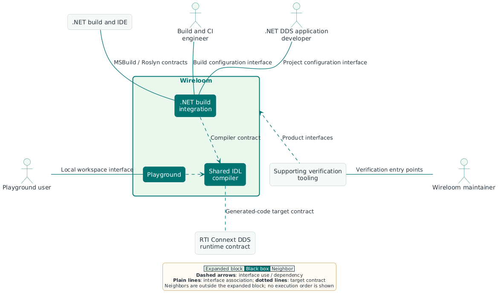
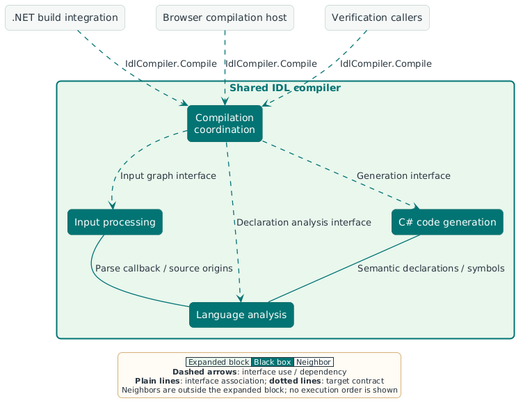
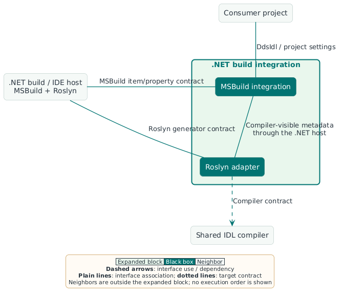
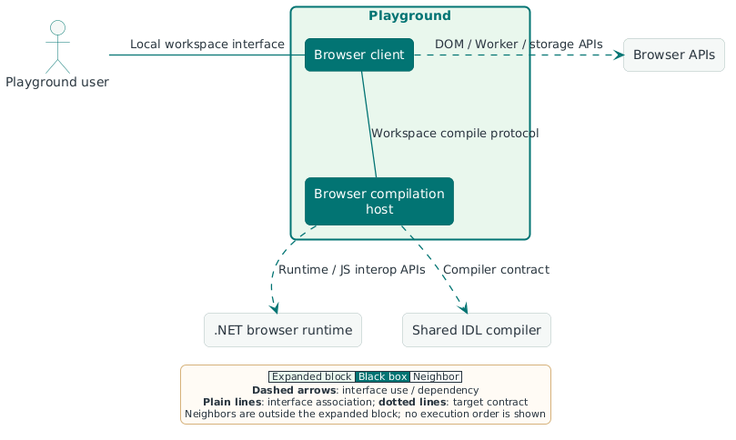
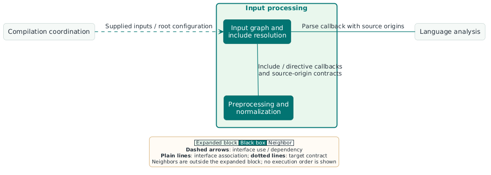
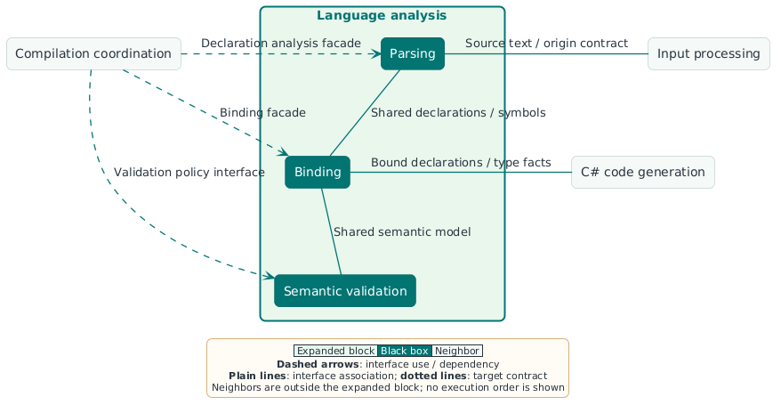
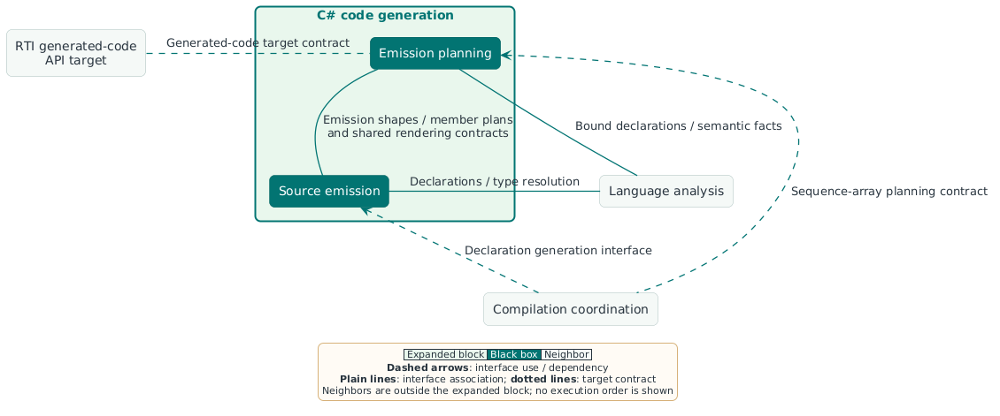
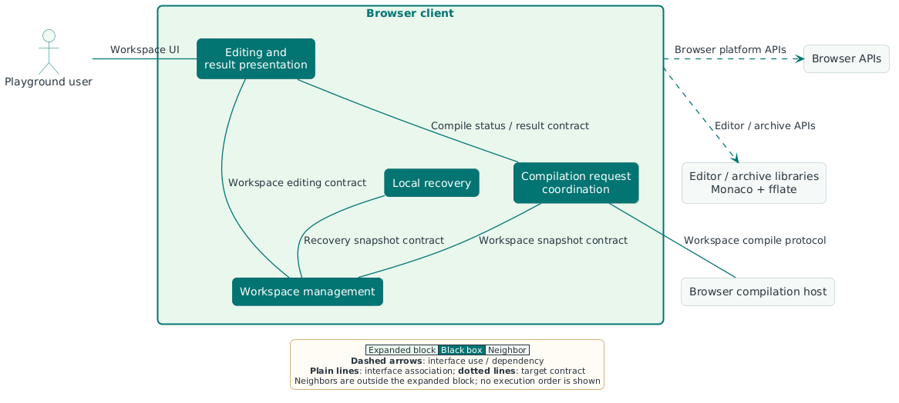
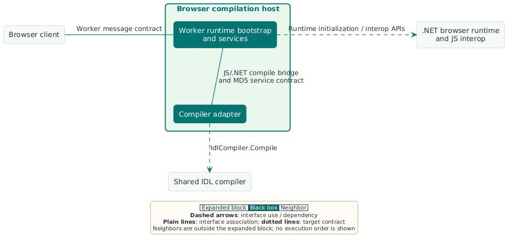

# 5. Building block view

This chapter describes the product's static structure: containment,
responsibilities, provided and required interfaces, and dependencies.
[Chapter 6](06-runtime-view.md) describes collaboration at runtime;
[chapter 7](07-deployment-view.md) describes packaging and deployment.

## 5.1 Hierarchy and notation

The hierarchy follows the [product boundary](03-context-and-scope.md) and
[architectural choices](04-solution-strategy.md):

```text
Wireloom
├── Shared IDL compiler
│   ├── Compilation coordination
│   ├── Input processing
│   │   ├── Input graph and include resolution
│   │   └── Preprocessing and normalization
│   ├── Language analysis
│   │   ├── Parsing
│   │   ├── Binding
│   │   └── Semantic validation
│   └── C# code generation
│       ├── Emission planning
│       └── Source emission
├── .NET build integration
│   ├── MSBuild integration
│   └── Roslyn adapter
└── Playground
    ├── Browser client
    │   ├── Workspace management
    │   ├── Editing and result presentation
    │   ├── Compilation request coordination
    │   └── Local recovery
    └── Browser compilation host
        ├── Worker runtime bootstrap and services
        └── Compiler adapter
```

Each diagram expands exactly one parent as a [white box](12-glossary.md#white-box).
Pale green identifies that expanded block, dark teal identifies its children as
[black boxes](12-glossary.md#black-box), and gray identifies
neighbors outside the expanded block. A neighbor can be another Wireloom
block. Lines identify static interfaces and dependencies.

The shared compiler has one place in the tree. Its callers depend on it.
Interfaces, data models, and generated documents are described with their
owning blocks. Supporting verification tooling is outside the product tree.

The views use the shared [Wireloom theme](images/wireloom-theme.puml) and the
chapter-specific [structural legend](images/05/legend.puml).

## 5.2 Level 1: Wireloom



| Block                  | Function and ownership                                                   | Interfaces and dependencies                                                                              | Implementation reference                                                                                                                                       |
| :--------------------- | :----------------------------------------------------------------------- | :------------------------------------------------------------------------------------------------------- | :------------------------------------------------------------------------------------------------------------------------------------------------------------- |
| Shared IDL compiler    | Own IDL meaning, diagnostics, and generated C#                           | Provides the in-memory compiler contract; requires explicit inputs, profile, and host services           | [Compiler entry point](../../../src/Wireloom.Dds.Compiler/Api/IdlCompiler.cs)                                                                                  |
| .NET build integration | Adapt consumer projects and compiler results to .NET build/IDE contracts | Provides project configuration and analyzer integration; requires MSBuild/Roslyn and the shared compiler | [Generator](../../../src/Wireloom.Dds.Generator/Api/Generator.cs), [MSBuild targets](../../../src/Wireloom.Dds.Generator/build/Wireloom.Dds.Generator.targets) |
| Playground             | Provide local interactive evaluation of generated C# and diagnostics     | Provides workspace/editor interfaces; requires browser APIs and the shared compiler                      | [Browser client composition](../../../playground/src/main.ts), [compiler adapter](../../../src/Wireloom.Playground.Browser/PlaygroundCompilerAdapter.cs)       |

The human neighbors are the four roles defined in
[chapter 1](01-introduction-and-goals.md#13-stakeholders). .NET build/IDE
tooling provides the hosting APIs. The RTI runtime defines the generated-code
target contract; this relationship does not introduce an RTI assembly
dependency into the shared compiler. Verification tooling uses product
interfaces and is described separately in [section 5.5](#55-supporting-verification-tooling).

## 5.3 Level 2: Product blocks

### 5.3.1 Shared IDL compiler



| Child                        | Function and ownership                                                           | Provided and required interfaces                                                                                     | Implementation reference                                                                                                                                                                                         |
| :--------------------------- | :------------------------------------------------------------------------------- | :------------------------------------------------------------------------------------------------------------------- | :--------------------------------------------------------------------------------------------------------------------------------------------------------------------------------------------------------------- |
| **Compilation coordination** | Own one compilation's configuration, state, diagnostics, and document collection | Provides `IdlCompiler.Compile`; requires the input, analysis, and generation interfaces                              | [IdlCompiler](../../../src/Wireloom.Dds.Compiler/Api/IdlCompiler.cs), [IdlCompilation](../../../src/Wireloom.Dds.Compiler/Compiler/IdlCompilation.cs)                                                            |
| **Input processing**         | Own supplied roots/includes, preprocessing, and source-origin information        | Requires supplied `IdlInput` values and settings; provides text/origin data through a parsing callback               | [IdlInputGraph](../../../src/Wireloom.Dds.Compiler/Compiler/FrontEnd/Preprocessing/IdlInputGraph.cs)                                                                                                             |
| **Language analysis**        | Own declarations, symbols, bound meaning, and semantic findings                  | Requires source text/origins and semantic policy; provides declarations, symbols, values, and diagnostics            | [IdlDeclarationParser](../../../src/Wireloom.Dds.Compiler/Compiler/FrontEnd/Parsing/IdlDeclarationParser.cs), [IdlParseContext](../../../src/Wireloom.Dds.Compiler/Compiler/FrontEnd/Parsing/IdlParseContext.cs) |
| **C# code generation**       | Own generated API/storage shapes and source documents                            | Requires semantic declarations, type resolution, profile, and mapping settings; provides `GeneratedIdlSource` values | [IdlDeclarationEmitter](../../../src/Wireloom.Dds.Compiler/Compiler/Emission/IdlDeclarationEmitter.cs)                                                                                                           |

The compiler's neighbors are .NET build integration, the browser compilation
host, and direct verification callers. The public API is an interface on the
compiler, implemented through compilation coordination.

#### Compiler contract and payload examples

The provided interface is defined by
[IdlCompiler](../../../src/Wireloom.Dds.Compiler/Api/IdlCompiler.cs):

```csharp
IdlCompilationResult Compile(
    IReadOnlyList<IdlInput> inputs,
    IdlCompilerProfile profile,
    Func<byte[], byte[]> computeMd5,
    CancellationToken cancellationToken = default);
```

Example input values contain complete source text, including supplied include
files. These paths identify the supplied inputs; the core has no filesystem
dependency.

```csharp
IReadOnlyList<IdlInput> inputs =
[
    new(
        path: "contracts/sample.idl",
        text:
          """
          #include "types.idl"
          struct Sample { Count value; };
          """,
        generate: true),
    new(
        path: "contracts/types.idl",
        text: "typedef long Count;",
        generate: false),
];
IdlCompilerProfile profile = IdlCompilerProfile.Rti770;
```

The required MD5 delegate accepts UTF-8 bytes and returns a complete 16-byte
digest, as specified in [ADR-002](../adr/ADR-002-inject-member-id-md5-per-compilation.md).
The result contract contains `Documents`, `Diagnostics`, and `Success`.
Each [generated document](../../../src/Wireloom.Dds.Compiler/Api/GeneratedIdlSource.cs)
contains a deterministic `HintName` and complete C# `Source`.

An example [diagnostic payload](../../../src/Wireloom.Dds.Compiler/Api/IdlDiagnostic.cs)
is represented by the actual compiler type:

```csharp
new IdlDiagnostic(
    "DDSG0001",
    IdlDiagnosticSeverity.Error,
    new IdlInput("contracts/sample.idl",
        """
        #include "missing.idl"
        """),
    0,
    "Could not resolve included IDL: missing.idl");
```

Its `Path` and `SourceText` come from the supplied input; `Offset` is a
zero-based UTF-16 source offset. Detailed diagnostic policy is in
[chapter 8](08-crosscutting-concepts.md#82-source-provenance-and-failure-reporting).

### 5.3.2 .NET build integration



| Child                   | Function and ownership                                                                  | Provided and required interfaces                                                                                              | Implementation reference                                                                                                                                                                                                                                                                                                                          |
| :---------------------- | :-------------------------------------------------------------------------------------- | :---------------------------------------------------------------------------------------------------------------------------- | :------------------------------------------------------------------------------------------------------------------------------------------------------------------------------------------------------------------------------------------------------------------------------------------------------------------------------------------------ |
| **MSBuild integration** | Define project-facing IDL inputs and compiler-visible settings                          | Provides `DdsIdl` items, properties, and additional-file metadata through the MSBuild host                                    | [Wireloom.Dds.Generator.targets](../../../src/Wireloom.Dds.Generator/build/Wireloom.Dds.Generator.targets)                                                                                                                                                                                                                                        |
| **Roslyn adapter**      | Own host applicability, input translation, compiler invocation, and result presentation | Requires Roslyn additional files/options/references and the compiler API; provides generated documents and Roslyn diagnostics | [Generator](../../../src/Wireloom.Dds.Generator/Api/Generator.cs), [input factory](../../../src/Wireloom.Dds.Generator/Roslyn/GeneratorInputFactory.cs), [runtime reference guard](../../../src/Wireloom.Dds.Generator/Roslyn/RuntimeReferenceGuard.cs), [diagnostic mapping](../../../src/Wireloom.Dds.Generator/Roslyn/GeneratorDiagnostics.cs) |

The two children share the compiler-visible metadata contract supplied by
MSBuild/Roslyn. The external host owns that transport. The Roslyn adapter
examines the resolved RTI assembly identity through compilation metadata.

Example consumer configuration payload:

```xml
<ItemGroup>
  <DdsIdl Include="contracts/sample.idl"
          IncludeDirectories="contracts/includes"
          Defines="FEATURE_X"
          Strict="true" />
</ItemGroup>
```

The adapter's input metadata includes keys such as
`build_metadata.AdditionalFiles.Generate` and
`build_metadata.AdditionalFiles.Strict`. The
[configuration guide](../../guides/configuration.md) owns the full settings
contract and precedence rules.

### 5.3.3 Playground



| Child                        | Function and ownership                                                                          | Provided and required interfaces                                                                                                            | Implementation reference                                                                                                                       |
| :--------------------------- | :---------------------------------------------------------------------------------------------- | :------------------------------------------------------------------------------------------------------------------------------------------ | :--------------------------------------------------------------------------------------------------------------------------------------------- |
| **Browser client**           | Own workspace interaction, editor/result presentation, request coordination, and local recovery | Provides the user interface and typed workspace requests; requires browser APIs, editor/archive libraries, and the browser compilation host | [Client composition](../../../playground/src/main.ts), [protocol mirror](../../../playground/src/protocol.ts)                                  |
| **Browser compilation host** | Own the browser-compatible compiler boundary and its platform services                          | Provides the workspace compile contract; requires .NET browser runtime/interop and the shared compiler                                      | [Worker bridge](../../../playground/src/worker.mjs), [compiler adapter](../../../src/Wireloom.Playground.Browser/PlaygroundCompilerAdapter.cs) |

The shared compiler is the Playground's sibling. Its implementation has one
owner in the product tree. The Playground user, browser APIs, and .NET browser
runtime are neighbors of this view.

#### Workspace protocol payload examples

The .NET adapter DTOs own the JSON contract; TypeScript mirrors it.
[The workspace guide](../../guides/playground-workspaces.md#worker-contract-v3)
is the authoritative protocol reference. Example request payload:

```json
{
  "protocolVersion": 3,
  "workerGeneration": 1,
  "requestId": 1,
  "workspaceRevision": 1,
  "profile": "7.7.0",
  "files": [
    {
      "path": "/workspace/main.idl",
      "source": "#include \"missing.idl\"",
      "isGenerationRoot": true,
      "options": {
        "defines": [],
        "undefines": [],
        "strict": false
      }
    }
  ],
  "options": {
    "sequenceArrayMapping": "RtiCSharp",
    "sequenceSize": 100,
    "stringSize": 255,
    "includeDirectories": [],
    "enableEscapeChar": false
  }
}
```

The corresponding compiler-response payload illustrates the document and
diagnostic fields. The worker message union wraps this payload in
`{ "type": "result", "response": ... }`.

```json
{
  "protocolVersion": 3,
  "workerGeneration": 1,
  "requestId": 1,
  "workspaceRevision": 1,
  "profile": "7.7.0",
  "kind": "compiler",
  "success": false,
  "documents": [],
  "diagnostics": [
    {
      "id": "DDSG0001",
      "severity": "Error",
      "message": "Could not resolve included IDL: missing.idl",
      "filePath": "/workspace/main.idl",
      "startOffset": 0,
      "length": 0
    }
  ],
  "error": null
}
```

Compiler diagnostics have no span length in the current core API; the browser
DTO's `length` is zero. Host outcome variants are documented in
[chapter 6](06-runtime-view.md#621-preview-the-current-workspace); protocol rules
are in the [worker contract](../../guides/playground-workspaces.md#worker-contract-v3).

## 5.4 Level 3: Selected child blocks

### 5.4.1 Input processing



| Child                                  | Function and ownership                                                       | Provided and required interfaces                                                                                    | Implementation reference                                                                                                                                                                                                           |
| :------------------------------------- | :--------------------------------------------------------------------------- | :------------------------------------------------------------------------------------------------------------------ | :--------------------------------------------------------------------------------------------------------------------------------------------------------------------------------------------------------------------------------- |
| **Input graph and include resolution** | Own the supplied input map, root/include identity, and include lookup        | Requires supplied sources/settings and the parsing callback; provides source-associated text and origin facts       | [IdlInputGraph](../../../src/Wireloom.Dds.Compiler/Compiler/FrontEnd/Preprocessing/IdlInputGraph.cs), [IdlIncludeResolver](../../../src/Wireloom.Dds.Compiler/Compiler/FrontEnd/Preprocessing/IdlIncludeResolver.cs)               |
| **Preprocessing and normalization**    | Own directives/macros, escaped-name normalization, and source-origin mapping | Requires source text and include/directive callbacks; provides processed text, origins, and identifier-offset facts | [IdlPreprocessor](../../../src/Wireloom.Dds.Compiler/Compiler/FrontEnd/Preprocessing/IdlPreprocessor.cs), [IdlEscapeCharNormalizer](../../../src/Wireloom.Dds.Compiler/Compiler/FrontEnd/Preprocessing/IdlEscapeCharNormalizer.cs) |

The parsing [callback](12-glossary.md#callback) contract carries text, the owning `IdlInput`, offset,
namespace, source origins, and escaped-identifier offsets. Include resolution
and preprocessing share callback contracts; the tree records ownership rather
than a strictly sequential pipeline. The
[compiler-input example](#compiler-contract-and-payload-examples) shows the supplied root/include payload.

### 5.4.2 Language analysis



| Child                   | Function and ownership                                                                      | Provided and required interfaces                                                                                 | Implementation reference                                                                                                                                                                                                                                                                               |
| :---------------------- | :------------------------------------------------------------------------------------------ | :--------------------------------------------------------------------------------------------------------------- | :----------------------------------------------------------------------------------------------------------------------------------------------------------------------------------------------------------------------------------------------------------------------------------------------------- |
| **Parsing**             | Own recognized declaration/annotation syntax and source-associated declaration construction | Requires processed source and origin facts; provides declarations and symbol entries through the analysis facade | [IdlDeclarationParser](../../../src/Wireloom.Dds.Compiler/Compiler/FrontEnd/Parsing/IdlDeclarationParser.cs), [IdlSyntaxReader](../../../src/Wireloom.Dds.Compiler/Compiler/FrontEnd/Parsing/IdlSyntaxReader.cs)                                                                                       |
| **Binding**             | Own name/type resolution, constants, defaults, bounds, and effective metadata               | Requires declarations and the symbol model; provides bound semantic facts and source-located findings            | [IdlParseContext](../../../src/Wireloom.Dds.Compiler/Compiler/FrontEnd/Parsing/IdlParseContext.cs), [IdlTypeBinder](../../../src/Wireloom.Dds.Compiler/Compiler/FrontEnd/Semantic/IdlTypeBinder.cs), [IdlValueBinder](../../../src/Wireloom.Dds.Compiler/Compiler/FrontEnd/Semantic/IdlValueBinder.cs) |
| **Semantic validation** | Own deferred semantic/specification checks and validation policy                            | Requires semantic declarations and policy; provides source-located findings                                      | [IdlSemanticValidator](../../../src/Wireloom.Dds.Compiler/Compiler/FrontEnd/Semantic/IdlSemanticValidator.cs), [IdlIdentifierValidator](../../../src/Wireloom.Dds.Compiler/Compiler/FrontEnd/Semantic/IdlIdentifierValidator.cs)                                                                       |

Declarations, symbols, values, source facts, and diagnostic contracts are
shared data owned within language analysis. Contextual checks also exist in
parsing and binding. This responsibility split does not claim hermetic passes.
Annotation and expression details are maintained in the
[semantic-binding concept](08-crosscutting-concepts.md#81-idl-meaning-and-identity).

### 5.4.3 C# code generation



| Child                 | Function and ownership                                                                 | Provided and required interfaces                                                                                                       | Implementation reference                                                                                                                                                                                                                                                                                         |
| :-------------------- | :------------------------------------------------------------------------------------- | :------------------------------------------------------------------------------------------------------------------------------------- | :--------------------------------------------------------------------------------------------------------------------------------------------------------------------------------------------------------------------------------------------------------------------------------------------------------------- |
| **Emission planning** | Own generated API/storage shapes, metadata, defaults, and member policies              | Requires bound declarations, type facts, profile, and mappings; provides emission models, member plans, and shared rendering contracts | [EmissionTypeProjector](../../../src/Wireloom.Dds.Compiler/Compiler/Emission/Planning/EmissionTypeProjector.cs), [MemberEmissionPlan](../../../src/Wireloom.Dds.Compiler/Compiler/Emission/Planning/EmissionMemberPlan.cs)                                                                                       |
| **Source emission**   | Own deterministic C# documents for managed types, native interop, and RTI type support | Requires declarations, plans, and type resolution; provides `GeneratedIdlSource` values                                                | [IdlDeclarationEmitter](../../../src/Wireloom.Dds.Compiler/Compiler/Emission/IdlDeclarationEmitter.cs), [GeneratedSourceWriter](../../../src/Wireloom.Dds.Compiler/Compiler/Emission/Writers/GeneratedSourceWriter.cs), [EmissionResult](../../../src/Wireloom.Dds.Compiler/Compiler/Emission/EmissionResult.cs) |

Planning and source emission share implementation and rendering helpers.
Their boundary is a set of model/helper contracts, rather than a standalone
frozen-plan artifact. Generated native interop support is C#; C++ peer tooling
belongs to supporting qualification.

The output payload is defined by [GeneratedIdlSource](../../../src/Wireloom.Dds.Compiler/Api/GeneratedIdlSource.cs):
`HintName` identifies the document, and `Source` contains its complete C#.
The [option-ownership concept](08-crosscutting-concepts.md#81-idl-meaning-and-identity)
and [mapping reference](../../guides/configuration.md#choose-the-sequence-array-mapping)
define the scope and effect of the selected emission settings.

### 5.4.4 Browser client



| Child                                | Function and ownership                                                                        | Provided and required interfaces                                                                                                         | Implementation reference                                                                                                                                                                                                           |
| :----------------------------------- | :-------------------------------------------------------------------------------------------- | :--------------------------------------------------------------------------------------------------------------------------------------- | :--------------------------------------------------------------------------------------------------------------------------------------------------------------------------------------------------------------------------------- |
| **Workspace management**             | Own virtual files/folders, roles/settings, and validated workspace changes, including imports | Provides workspace values and edit operations; requires source/path/settings data                                                        | [Workspace model and operations](../../../playground/src/workspace.ts), [workbench integration](../../../playground/src/workspace-ui.ts)                                                                                           |
| **Editing and result presentation**  | Own editor models, selection/undo, diagnostics, generated-document views, and exports         | Provides user-facing editor/result interfaces; requires workspace operations, compile results, browser APIs, Monaco, and archive helpers | [Editors](../../../playground/src/editors.ts), [SourceWorkbench](../../../playground/src/workspace-ui.ts), [application composition](../../../playground/src/main.ts), [source archive](../../../playground/src/source-archive.ts) |
| **Compilation request coordination** | Own the browser client's worker connection and request/result identity                        | Provides the client compile/status contract; requires workspace snapshots, Worker APIs, and the browser compilation host                 | [CompilerClient](../../../playground/src/compiler-client.ts), [protocol types](../../../playground/src/protocol.ts)                                                                                                                |
| **Local recovery**                   | Own persisted workspace snapshots and save/reset consistency                                  | Provides recovery load/save/delete interfaces; requires the workspace schema and IndexedDB                                               | [RecoveryStore](../../../playground/src/workspace.ts), [RecoverySaver](../../../playground/src/recovery-saver.ts)                                                                                                                  |

These are logical responsibilities. `main.ts` composes several of them, and `workspace.ts` contains both workspace
operations and the recovery-store implementation. Import/export ownership is distributed across the relevant
workspace and presentation code. The workspace model and worker payload have different purposes;
the [workspace guide](../../guides/playground-workspaces.md) defines their fields. Runtime request scheduling
and recovery scenarios belong in [chapter 6](06-runtime-view.md#62-playground-evaluation).

### 5.4.5 Browser compilation host



| Child                                     | Function and ownership                                                   | Provided and required interfaces                                                                                            | Implementation reference                                                                                                                                                  |
| :---------------------------------------- | :----------------------------------------------------------------------- | :-------------------------------------------------------------------------------------------------------------------------- | :------------------------------------------------------------------------------------------------------------------------------------------------------------------------ |
| **Worker runtime bootstrap and services** | Own the JS/.NET bridge and host-provided MD5 implementation              | Provides worker messages, assembly-export access, and the digest service; requires .NET browser runtime and JS interop APIs | [Worker bridge](../../../playground/src/worker.mjs), [MD5 provider](../../../playground/src/md5.mjs), [.NET exports](../../../src/Wireloom.Playground.Browser/Program.cs) |
| **Compiler adapter**                      | Own protocol validation, input/result mapping, and result-size contracts | Provides typed compile request/response DTOs; requires the compiler API and host digest service                             | [PlaygroundCompilerAdapter](../../../src/Wireloom.Playground.Browser/PlaygroundCompilerAdapter.cs)                                                                        |

This block spans JavaScript and C#. Worker lifecycle/request coordination
belongs to the browser client. See the [protocol payloads](#workspace-protocol-payload-examples)
and [shared compiler interface](#compiler-contract-and-payload-examples).

## 5.5 Supporting verification tooling

Verification tooling is a neighbor of the product and uses its compiler,
analyzer, and browser interfaces. Its ownership is separate from the product
hierarchy.

| Supporting area                                                  | Function and interfaces                                                                                                                  | Reference                                                                                                                                                                                                             |
| :--------------------------------------------------------------- | :--------------------------------------------------------------------------------------------------------------------------------------- | :-------------------------------------------------------------------------------------------------------------------------------------------------------------------------------------------------------------------- |
| **Compiler, corpus, package, runtime, and browser verification** | Verify public/internal contracts through focused tests, retained fixtures, real analyzer consumption, and browser protocol/UI interfaces | [Contribution guide](../../../CONTRIBUTING.md#tests-and-fixtures), [evidence scope](08-crosscutting-concepts.md#85-compatibility-and-evidence), [Playground qualification](../../testing/playground-qualification.md) |
| **Wire qualification tooling**                                   | Own fixture/peer preparation and evidence/report contracts through the Runner and Verifier applications and their shared library         | [Wire harness code map](../../../tests/Wireloom.Dds.Generator.WireCompatibility/README.md#code-map), [report contracts](../../../tests/Wireloom.Dds.Generator.WireCompatibility/README.md#read-the-results)           |

Harness execution scenarios belong in [chapter 6](06-runtime-view.md#632-qualify-dds-exchanges-and-retained-reports);
its execution environments are documented in the
[wire runbook](../../../tests/Wireloom.Dds.Generator.WireCompatibility/README.md#github-actions).

---

[< 4. Solution strategy](04-solution-strategy.md) | [Index](index.md) | [6. Runtime view >](06-runtime-view.md)
