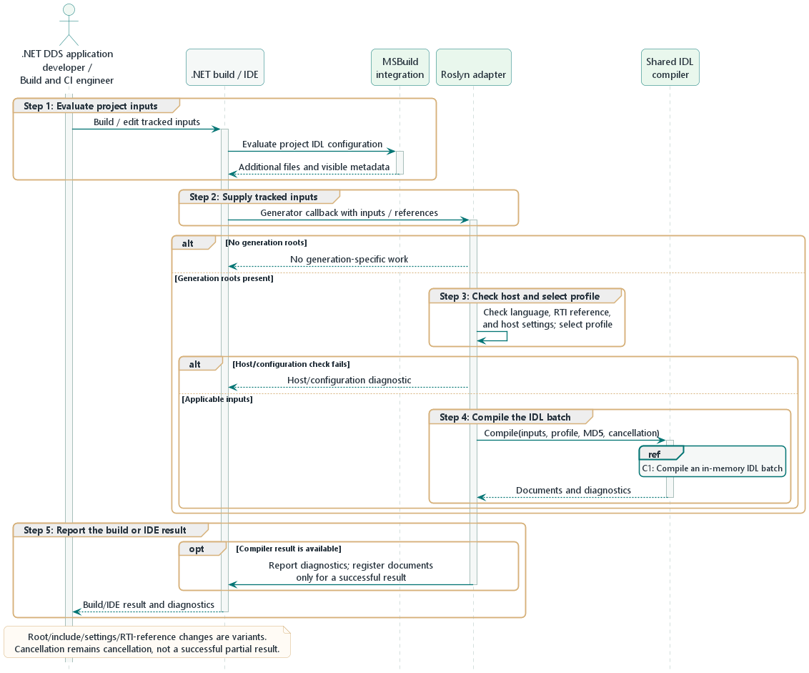

# 6. Runtime view

Wireloom has no long-running server process. Its runtime scenarios include the
consumer's build, the browser Playground's local WebAssembly compilation, and
the generated application's later use of the RTI runtime.

## 6.1 Consumer build and generation

1. MSBuild adds explicit `DdsIdl` roots and tracks other `.idl` files as
   non-generating inputs. Root metadata determines strictness for the batch;
   project properties provide effective limits and the batch-wide
   `DdsIdlEnableEscapeChar` name-normalization setting.
2. Roslyn supplies the files, item metadata, compiler options, and compilation
   references to `Generator`.
3. The generator requires C# 12 or later and a resolved RTI runtime reference
   of at least 7.3.1. The Roslyn adapter reads the resolved assembly version
   and maps it to a supported profile through the shared compiler API.
4. `IdlCompiler` resolves the include graph and preprocesses input. If escape
   normalization is enabled, a token-aware pass removes one leading underscore
   from identifiers and composes source origins before parsing. The front end
   then binds normalized references and deferred bounds against the complete
   symbol graph and validates semantics using the batch policy.
5. The adapter calls `IdlCompiler.Compile` with in-memory inputs, the selected
   profile, and its MD5 provider. The core snapshots the input list,
   preprocesses and validates IDL, then returns one result containing
   documents and diagnostics. Emission planning applies profile-specific API policies.
   Deliberately ignored constructs and potentially lossy mappings report
   diagnostics while generation continues; see the
   [diagnostic rules](08-crosscutting-concepts.md#82-diagnostics-and-source-locations).
6. The consumer compiles generated types together with its hand-written code.

Binding order is explicit: integral, boolean, character, and enum constants, deferred collection
bounds, string and floating constants, explicit and inherited typedef defaults,
inheritance and member types, member annotation values, then effective member
IDs. Semantic validation and emission planning follow these stages. Original
source offsets are captured before work is queued; binding does not depend on
the parser's current input or source mapping.

Macro argument binding, stringification, token pasting, and replacement
rescanning happen during preprocessing. Adjacent string literals retain their
token boundaries through that stage. Value binding decodes each literal token,
concatenates the decoded values, and validates the final encoded length.
Emission formats the bound value for C# without replaying IDL expressions or
applying text replacement to literal contents.

The adapter resolves direct sequence-array mapping from file metadata first,
then the project property, defaulting to `RtiCSharp`. The source file owns the
choice even when reached through multiple roots. Effective sequence and string
limits use file metadata first, then project properties, then defaults of 100
elements and 255 UTF-8 bytes or UTF-16 code units. Explicit IDL bounds override
these effective limits. In `Idl` mode, planning
creates sequence-element wrappers and array metadata without rewriting the
semantic model. Other collections retain their existing emission paths.

Repository C# callers use the same synchronous API with an explicit
`IdlCompilerProfile` and supplied source text. The core resolves includes only
from the provided input collection and does not read files. An empty document
list with no error diagnostics is a successful compile; an empty document list
with an error is a failed compile. Expected IDL failures return source-located
`DDSG0001`; `DDSG0004` remains an error result with no documents. Warnings
collected before the first fatal error remain in that result. Cancellation and
unexpected exceptions propagate. The adapter converts input-configuration
errors and presents diagnostics through Roslyn before adding successful
documents.

## 6.2 Failure paths

- Missing or cyclic includes stop compilation with an IDL diagnostic.
- Unsupported syntax is rejected rather than silently dropped.
- Case-variant keywords and same-scope case-only names report `DDSG0108` and
  continue by default. Strict mode rejects them and new keys in derived types
  with source-located `DDSG0001` before emission.
- Exact reserved keyword identifiers fail in both modes. Suppressing a
  diagnostic does not restore output after semantic validation fails.
- With `DdsIdlEnableEscapeChar`, collisions created by normalized identifiers
  and the identifier `_` (which would normalize to an empty name) fail before
  emission. Implicit hash member IDs use normalized names.
- Invalid sequence-array settings and unsupported recursive direct sequence
  arrays in `Idl` mode produce `DDSG0001` with no partial source emission;
  there is no silent fallback to flattening. The default `RtiCSharp` mapping
  continues to report `DDSG0105` and generate its legacy shape.
- Non-positive or non-Int32 sequence/string size settings produce source-
  located `DDSG0001` before output for the affected input.
- An older language version produces `DDSG0002`.
- A missing compatible RTI runtime reference produces `DDSG0003`.
- Cyclic typedef aliases are rejected during semantic resolution with a source-
  located IDL diagnostic; they do not produce generated output.
- Cancellation is observed during input traversal and preprocessing. Macro-work
  or output limits fail the file with a stable source-located generator failure;
  partial preprocessed text is never passed to the parser.

## 6.3 Wire compatibility evidence

The manually dispatched workflow runs eight whole-case shards for each
qualified RTI profile. Each shard runs the Runner in the matching Docker
container: it creates a deterministic plan, builds selected managed and native
peers, then schedules exchanges with a unique DDS domain per active pair. The
scheduler starts readers before writers and is bounded to 16 exchanges by
default. Peer processes disable RTI Monitoring Library 2.0 because its
observability participant is not used by the matrix.

Each Runner invocation writes its plan, shard metadata, scenario outcomes, and
sanitized logs, including partial evidence on failure. After shard jobs finish,
the report job downloads their artifacts and runs the Verifier. The Verifier
checks assignment, completeness, uniqueness, and report consistency; its merge
command writes the combined report and evidence. Report assembly needs no RTI
license.

Peer and exchange failures remain visible in the report. Setup and evidence
finalization failures fail the job. Missing, duplicate, inconsistent, or
unrun scenarios cannot produce a complete report. See the
[wire compatibility runbook](../../../tests/Wireloom.Dds.Generator.WireCompatibility/README.md#case-shards-and-combined-reports)
for artifact and failure details.
## 6.4 Browser Playground compilation

The TypeScript client submits an immutable JSON workspace snapshot containing
protocol version, worker generation, monotonic request ID, workspace revision,
profile, normalized virtual paths, source text, generation-root flags,
file-owned mapping/size settings, and batch-wide preprocessing settings. It sends no host-machine file paths. The client keeps
one running request and replaces any pending request with the newest snapshot.
Source, path, role, settings, and profile changes make earlier responses stale.

A dedicated module worker initializes the published .NET runtime once, binds
the retained synchronous JavaScript MD5 provider in that worker, and reports
readiness. The .NET adapter validates the profile, path collection, total
UTF-8 input size, and output document/text caps, then calls
`IdlCompiler.Compile` with the same shared compiler and profile behavior as
native hosts. It returns every generated name and source with compiler
diagnostics and request identity. Diagnostics preserve the core's UTF-16
offset; the current core API does not provide a span length. Adapter and limit
failures are host outcomes and do not create compiler diagnostic IDs.

The page applies a response only when protocol version, worker generation,
request ID, workspace revision, and profile match the request and current
workspace. A synchronous compile cannot process cancellation on its busy
worker event loop. The client therefore rejects stale results and replaces a
timed-out or failed worker. A replacement reports startup failure and exposes
an explicit retry action. No compiler runs on the main thread.

Timeout errors remain visible only while their workspace request is current,
even after replacing the worker generation. When a replacement becomes ready,
it drains the newest queued snapshot. An idle worker failure clears previously
shown output so stale documents are not presented as current.

The current boundaries are 256 KiB of total UTF-8 source, 512 documents, and
16 MiB of generated UTF-8 text. Startup and compilation watchdogs are 30
seconds and 10 seconds. They constrain accepted work but do not provide a hard
browser-memory quota. Eight deterministic state tests cover newest-pending
retention, full response identity, worker replacement, startup failure,
recovery, timeout identity, and queued-work draining.

Stage 0 browser acceptance passed on Windows Edge 156.0.4314.42. The eight-case
corpus matched exact document names, generated source, success state, and
diagnostics for both RTI profiles at the site root and `/playground/` (32
comparisons). Repeated compilation and profile switching passed. Fresh isolated
context worker readiness took 149 ms at root and 159 ms under `/playground/`;
reload readiness took 124 ms and 122 ms, respectively. Worker resources
transferred 5,798,222 bytes per path (5,792,822 encoded bytes). A
128-declaration case producing 512 documents compiled in 357.1 ms. During that
run, a main-thread edit took 30.7 ms and the maximum observed heartbeat was
16.5 ms.

All five injected fault scenarios passed: missing-worker retry, MD5 provider
error classification and retry, idle worker exception and replacement, the
10-second watchdog rejecting stale work while retaining new pending input, and
current-request timeout reporting followed by successful recompilation. Three
additional validation groups passed: retry after a missing `dotnet.native`
asset, UI rejection of oversized ASCII and UTF-8 input before posting, and
worker reuse after malformed protocol/profile, aggregate-input-limit, and
result-document-limit requests. The observed application requests were GETs to
loopback; no outbound source-bearing request was observed.

This is representative Edge evidence, not cross-browser or release
qualification. Browser matrix coverage remains tracked by issue #110.

The Stage 1 discovery UI now compiles edits after a 300 ms debounce and compiles
example, import, profile, and restored-workspace changes immediately. Each
change invalidates exports and diagnostic offsets before dispatch. Previous
code remains visibly outdated while pending; current failures clear its models
and tabs. Successful zero-document output is distinct from failure. Diagnostic
navigation maps the compiler's UTF-16 offset through the exact input model;
diagnostics without that source remain list-only.

Imports read multiple UTF-8 files by basename into the selected virtual folder.
Per-file Replace/Skip/Rename choices are staged; Cancel, decode errors, invalid
paths, and bounds failures leave the workspace/result intact. Folder and file
moves preserve source text and stable editor identities, while configured
include-folder paths follow folder moves. Tree navigation, context menus, and
Move to provide keyboard alternatives to drag/drop.

All Roots compile as one batch; Include-only files participate through includes.
Quoted includes search locally before configured folders; angle includes search
configured folders only, in ordinal alphabetical order. Each source keeps its
own Monaco model and undo history. Diagnostics select the matching source tab.
Empty workspaces do not dispatch; files without a Root produce a workspace
error without a source location and clear generated output.

IndexedDB v3 recovery stores files, explicit folders, roles, settings, profile,
and active source identity. Unsupported workspace record versions report a
recovery error. Restore never overwrites edits made while storage is opening;
serialized saves and deletion preserve reset ordering. Unavailable or invalid
recovery leaves editing usable. Output is regenerated from source snapshots.
See the [workspace guide](../../guides/playground-workspaces.md).

The [qualification guide](../../testing/playground-qualification.md) records
representative Edge flows, native download comparisons, recovery, limits,
worker failures, and the #119 workspace verification scope.
