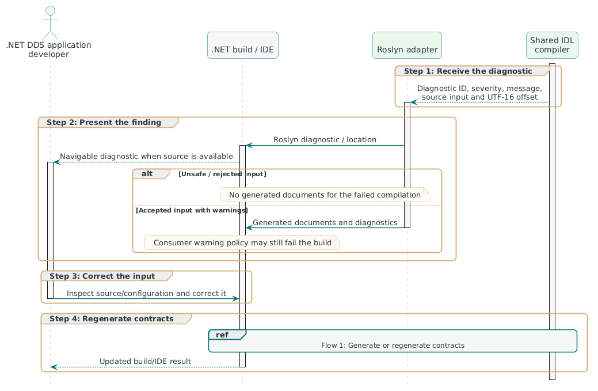
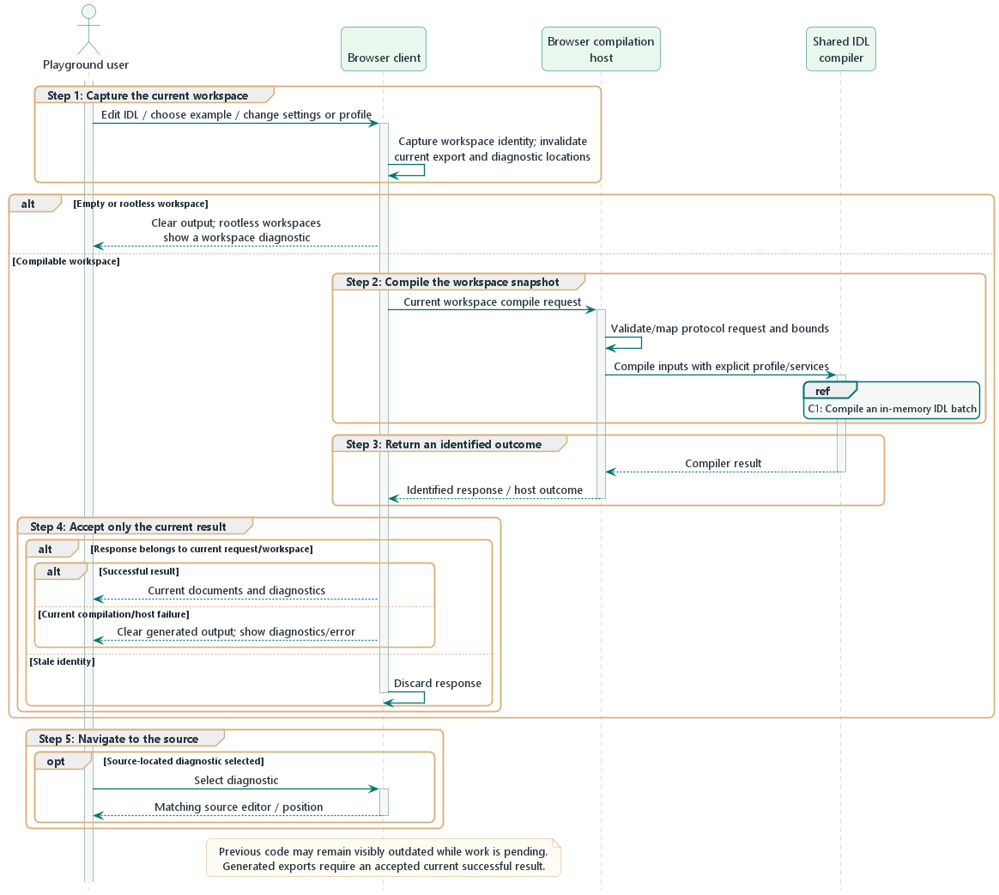
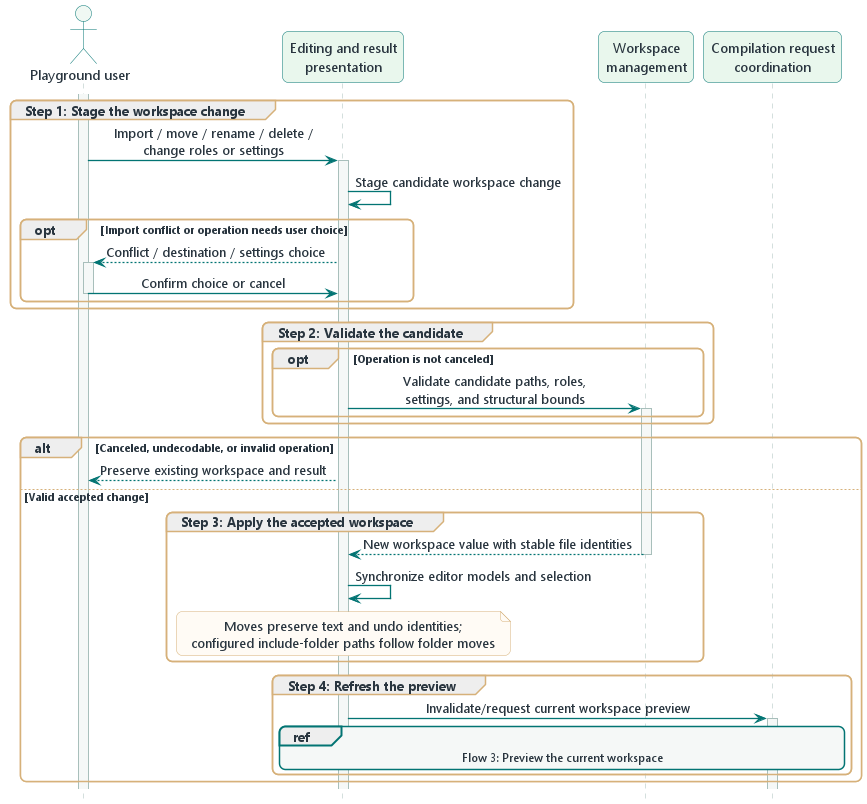
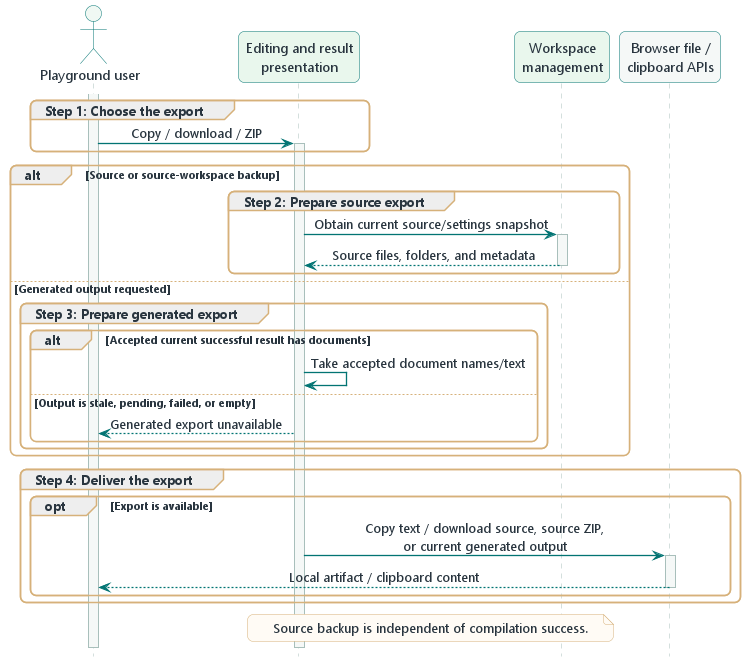
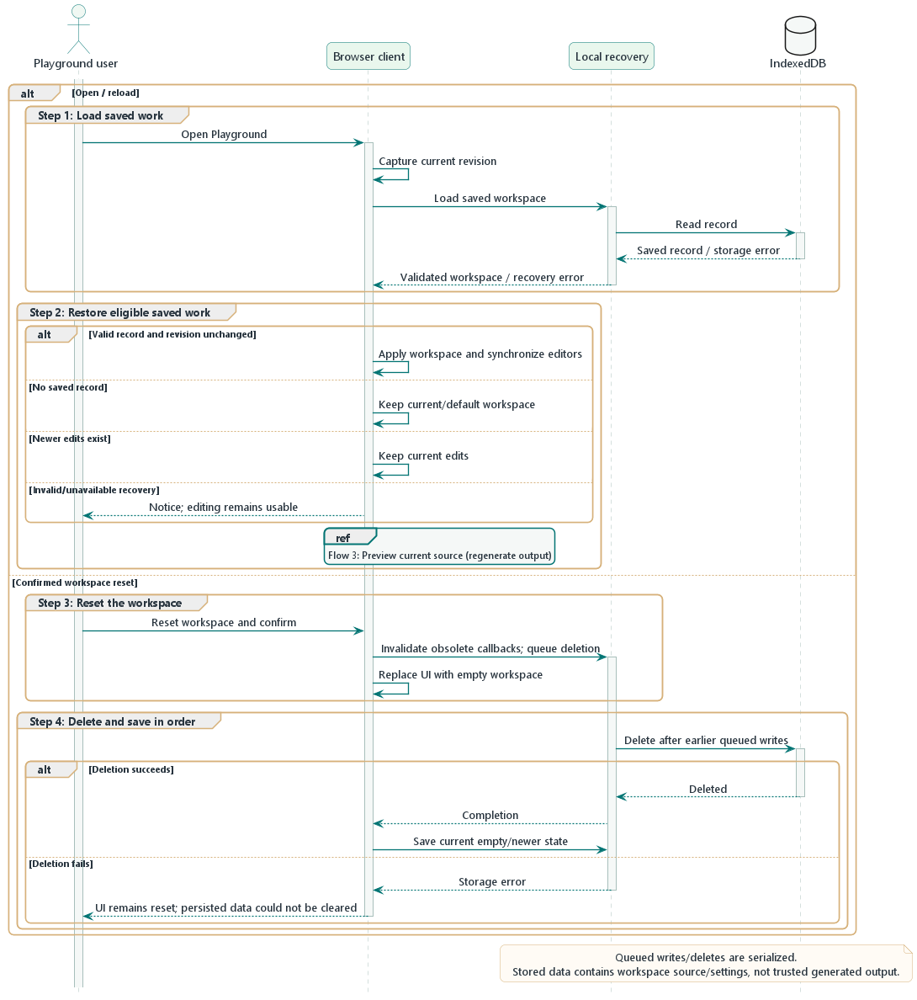
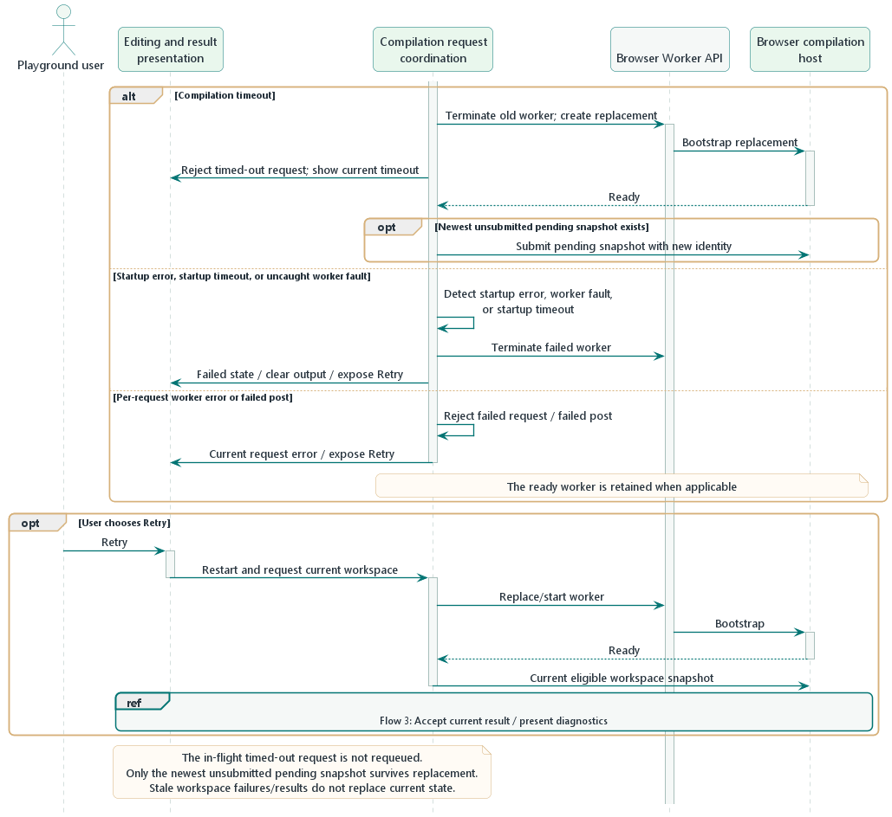
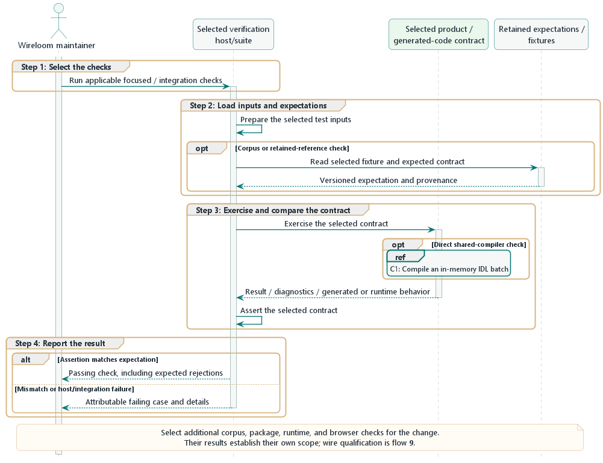
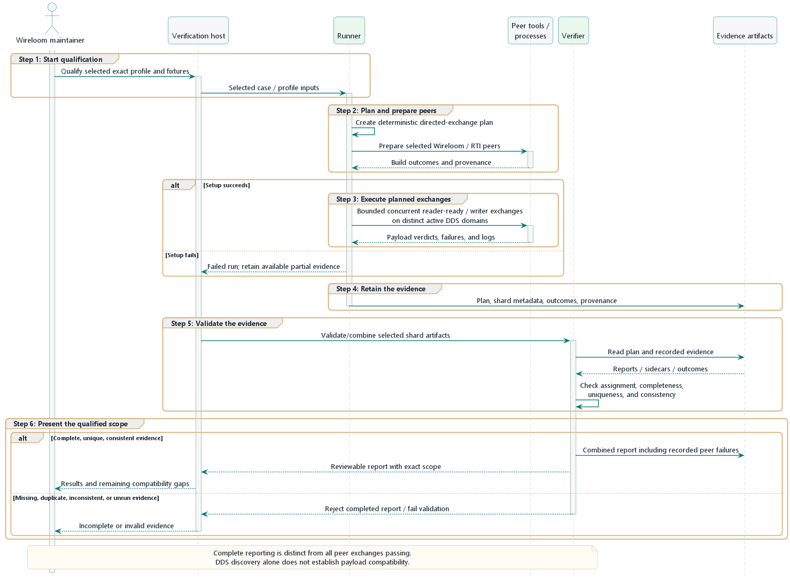
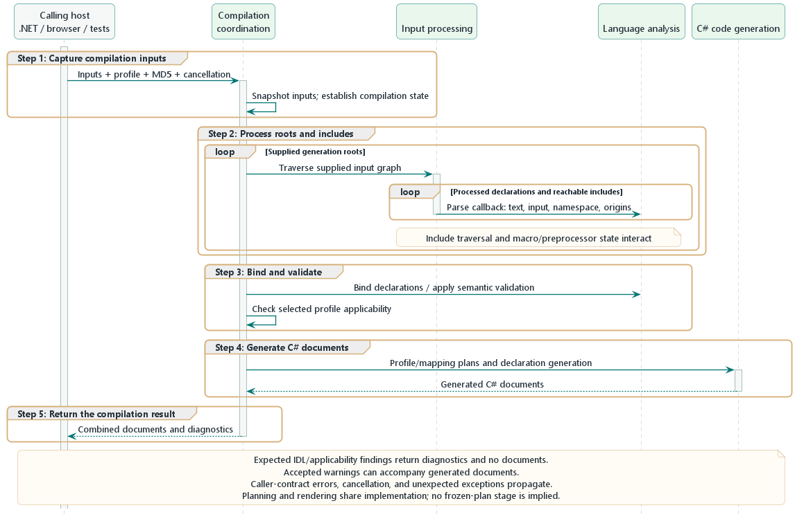

# 6. Runtime view

This chapter describes functional outcomes and collaboration between the
[building blocks](05-building-block-view.md). Sequence diagrams use the shared
[Wireloom theme](images/wireloom-theme.puml) and a
[sequence style](images/06/sequence-style.puml). Numbered Step groups match the
numbered steps below each diagram. A step can contain several messages;
named branches show alternatives. Referenced subflows avoid repeating the shared compiler.

The main flows cover the four [stakeholder roles](01-introduction-and-goals.md#13-stakeholders).
Supporting verification is identified separately from product use. Ordinary
consumer-application DDS operation remains outside the product boundary;
the wire scenario below concerns qualification peers.

| Flow                                                                                         | Main initiator                                          | Intended outcome                                                       |
| :------------------------------------------------------------------------------------------- | :------------------------------------------------------ | :--------------------------------------------------------------------- |
| [1. Generate or regenerate contracts](#611-generate-or-regenerate-application-contracts)     | .NET DDS application developer or Build and CI engineer | Generated C# reflects current IDL and project inputs                   |
| [2. Diagnose and correct generation problems](#612-diagnose-and-correct-generation-problems) | .NET DDS application developer                          | Correct the relevant IDL or configuration and obtain an updated result |
| [3. Preview the current workspace](#621-preview-the-current-workspace)                       | Playground user                                         | See current generated documents or diagnostics                         |
| [4. Change a workspace safely](#622-change-a-workspace-safely)                               | Playground user                                         | Apply an accepted workspace change consistently                        |
| [5. Export source or generated output](#623-export-source-or-current-generated-output)       | Playground user                                         | Obtain the intended local source/output artifact                       |
| [6. Restore or reset a workspace](#624-restore-or-reset-the-local-workspace)                 | Playground user                                         | Recover saved work or retain a reset/current workspace                 |
| [7. Recover browser compilation](#625-recover-browser-compilation-after-a-host-failure)      | Playground user or host failure                         | Restore usable compilation with the correct current request            |
| [8. Verify a change](#631-verify-a-compiler-or-integration-change)                           | Wireloom maintainer                                     | Establish attributable results for the affected contracts              |
| [9. Qualify DDS exchanges and reports](#632-qualify-dds-exchanges-and-retained-reports)      | Wireloom maintainer                                     | Review exact-scope exchange results and trustworthy evidence           |
| [C1. Compile an IDL batch](#64-c1-compile-an-in-memory-idl-batch)                            | A compiler host                                         | Obtain documents and diagnostics from supplied inputs                  |

## 6.1 Application contract generation

### 6.1.1 Generate or regenerate application contracts

**Intent:** Generate application contracts during a build or IDE update.
Changes to roots, included IDL, project settings, or the resolved RTI reference
are variants of this same flow.

**Participants:** .NET DDS application developer or Build and CI engineer, .NET
build/IDE host, MSBuild integration, Roslyn adapter, and shared IDL compiler.

1. **Evaluate project inputs.**  
   The .NET host evaluates the consumer project's IDL configuration. MSBuild
   integration exposes roots, tracked include inputs, and compiler-visible
   settings.
2. **Supply tracked inputs.**  
   Roslyn supplies additional files, options, and compilation references to
   the adapter. With no generation roots, the adapter returns before its
   language/runtime checks and compiler invocation.
3. **Check host and select profile.**  
   For generation roots, the adapter checks the language version, resolved RTI
   reference, and host configuration, and selects the RTI profile.
4. **Compile the IDL batch.**  
   The adapter invokes [C1](#64-c1-compile-an-in-memory-idl-batch) with the
   in-memory inputs, profile, digest service, and cancellation token.
5. **Report the build or IDE result.**  
   The adapter reports compiler diagnostics and registers generated documents
   for a successful compiler result. The .NET host compiles them with the
   application's handwritten code and presents its build/IDE result.

**Alternatives:** Host/configuration failures produce the appropriate
diagnostic without invoking compilation. Expected compiler failures return
diagnostics without generated documents. Observed cancellation propagates as
cancellation rather than becoming an IDL diagnostic or successful partial
result. Corrected inputs use this same flow again.

The [configuration contract](../../guides/configuration.md), [version policy](../../guides/support-and-compatibility.md#rti-version-qualification),
and [incremental baseline](../../performance/incremental-generator-baseline.md)
define input scope and measured reuse behavior.

### 6.1.2 Diagnose and correct generation problems

**Intent:** Turn a generation finding into a correction at its relevant source.

**Participants:** .NET DDS application developer, shared IDL compiler, Roslyn adapter, and
build/IDE host.

1. **Receive the diagnostic.**  
   The compiler supplies a stable ID, severity, message, source input, and
   UTF-16 offset. Adapter-owned configuration/applicability findings use
   the host's diagnostic path.
2. **Present the finding.**  
   The adapter presents the finding through Roslyn, with its original IDL
   location when available, including locations in supplied include files.
3. **Correct the input.**  
   The developer inspects the finding and corrects IDL or configuration.
4. **Regenerate contracts.**  
   [Flow 1](#611-generate-or-regenerate-application-contracts) obtains the
   updated result.

**Alternatives:** Unsafe/rejected input has no generated documents for that
failed compilation. Deliberately ignored or potentially lossy behavior can
produce diagnostics alongside generated documents. The consumer's
warnings-as-errors policy can fail a build independently of compiler semantic
acceptance. A diagnostic without a usable source location remains a message.

The [failure-reporting concept](08-crosscutting-concepts.md#82-source-provenance-and-failure-reporting)
relates semantic acceptance to host diagnostic policy. The
[configuration reference](../../guides/configuration.md#control-diagnostics)
owns severity controls and strictness settings.

## 6.2 Playground evaluation

### 6.2.1 Preview the current workspace

**Intent:** Show generated C# or diagnostics for the user's current IDL,
settings, and profile.

**Participants:** Playground user, browser client, browser compilation host,
and shared IDL compiler.

1. **Capture the current workspace.**  
   Editing, example selection, or a settings/profile change updates the
   workspace identity. The client invalidates current export eligibility
   and old diagnostic positions.
2. **Compile the workspace snapshot.**  
   The client supplies an eligible workspace snapshot to the compilation host.
   The host validates/maps the protocol payload and invokes
   [C1](#64-c1-compile-an-in-memory-idl-batch).
3. **Return an identified outcome.**  
   The host returns documents, diagnostics, or a host outcome with request and
   workspace identity.
4. **Accept only the current result.**  
   The client accepts only the result matching the current request, workspace,
   profile, and worker identity, and presents current documents/diagnostics.
5. **Navigate to the source.**  
   Selecting a source-located diagnostic opens the matching source editor
   and position.

**Alternatives:** Empty/rootless workspaces clear generated output without
dispatch; rootless workspaces report a workspace finding. Stale responses are
discarded. Previous code can remain visibly outdated while newer work is
pending; a current failure clears generated output. Successful output with
zero documents remains distinct from failure. Host faults use
[flow 7](#625-recover-browser-compilation-after-a-host-failure).

Payloads are in [chapter 5](05-building-block-view.md#533-playground);
the [worker contract](../../guides/playground-workspaces.md#worker-contract-v3)
owns identity, validation, and bounds.

### 6.2.2 Change a workspace safely

**Intent:** Import, move, rename, delete, or configure workspace entries while
preserving a consistent workspace and editor state.

**Participants:** Playground user, Editing and result presentation, workspace
management, and compilation request coordination.

1. **Stage the workspace change.**  
   The user requests a workspace operation. The client stages candidate changes
   and obtains any conflict, destination, or settings choices.
2. **Validate the candidate.**  
   Workspace management validates the candidate paths, roles, settings, and
   structural bounds.
3. **Apply the accepted workspace.**  
   An accepted change supplies a new workspace value with stable file
   identities. Presentation synchronizes editor models and selections.
4. **Refresh the preview.**  
   The client invalidates the old preview and uses
   [flow 3](#621-preview-the-current-workspace) for the resulting workspace.

**Alternatives:** Canceled, undecodable, or invalid imports/operations preserve
the prior workspace and result. Moves preserve source text and editor undo
identity, while configured include-folder paths follow folder moves.
A structurally valid change can still produce IDL diagnostics; source include
text is not rewritten. Removing the last Root uses flow 3's rootless case.

The [workspace guide](../../guides/playground-workspaces.md#files-folders-and-import)
owns operation rules and settings scope.

### 6.2.3 Export source or current generated output

**Intent:** Copy or download the intended source, source workspace, or
generated documents.

**Participants:** Playground user, Editing and result presentation, workspace
management, and browser file/clipboard APIs.

1. **Choose the export.**  
   The user selects source or generated output and its copy/download/ZIP form.
2. **Prepare source export.**  
   Source export obtains the current source/workspace snapshot. Source ZIP
   includes files, explicit folders, and workspace settings/metadata.
3. **Prepare generated export.**  
   Generated export uses the accepted current response's document names/text.
4. **Deliver the export.**  
   Browser APIs deliver the selected content to a local file or clipboard.

**Alternatives:** Source backup is available independently of IDL compilation
success, including unfinished or rootless workspaces. Generated export is
unavailable while its output is pending, stale, or failed. Clipboard failures
produce a notice. Downloads are handed to the browser, which controls their
completion; ZIP/download handler errors can propagate without a themed notice.

See [results and exports](../../guides/playground-workspaces.md#results-exports-and-local-recovery)
for artifact contents and availability.

### 6.2.4 Restore or reset the local workspace

**Intent:** Restore saved work on opening/reloading, or reset the workspace
and its persisted state.

**Participants:** Playground user, browser client, local recovery, and IndexedDB.

1. **Load saved work.**  
   Initialization records the current revision and requests saved workspace
   data from local recovery.
2. **Restore eligible saved work.**  
   A valid record is applied only if the revision is unchanged. Editor models
   are synchronized, and [flow 3](#621-preview-the-current-workspace)
   regenerates output from source.
3. **Reset the workspace.**  
   A confirmed reset invalidates obsolete callbacks, queues persisted-record
   deletion, and replaces the UI with an empty workspace.
4. **Delete and save in order.**  
   Earlier queued saves complete before deletion. After successful deletion,
   the client saves the current empty or newer workspace state.

**Alternatives:** With no saved record, the current/default workspace remains.
New edits win over a delayed restore. Invalid/unavailable
recovery reports a notice while editing remains usable. If deletion fails,
the UI stays reset and reports that persisted data could not be cleared.
Invalidating save callbacks does not cancel already queued storage writes.
The recovery-error action **Clear saved data** preserves current editor state;
it deletes persisted data and saves the current workspace instead of resetting it.

Workspace recovery stores source/settings, with output recomputed rather
than trusted from storage. The [workspace guide](../../guides/playground-workspaces.md#results-exports-and-local-recovery)
owns the record contract.

### 6.2.5 Recover browser compilation after a host failure

**Intent:** Restore usable compilation while preserving the distinction
between current work, abandoned work, and pending work.

**Participants:** Playground user, Editing and result presentation, compilation
request coordination, Browser Worker APIs, and browser compilation host.

| Trigger                                                  | Collaboration and outcome                                                                                                 |
| :------------------------------------------------------- | :------------------------------------------------------------------------------------------------------------------------ |
| Compilation timeout                                      | Request coordination starts worker replacement and rejects the in-flight request; its still-current failure is presented  |
| Startup error, startup timeout, or uncaught worker fault | Request coordination marks the worker failed, terminates it, clears output, and exposes Retry; replacement requires Retry |
| Per-request worker error or failed post                  | The request is rejected and its current failure is shown; a ready worker remains usable for newer work                    |
| User chooses Retry                                       | The client invalidates output, starts a replacement, and requests compilation of the current eligible workspace           |

Only the newest pending **unsubmitted** snapshot survives replacement.
The in-flight timed-out request is not re-enqueued. A ready replacement can
dispatch pending work; with none, an edit or explicit Retry supplies a new
request. Retry does not dispatch empty/rootless/oversized workspaces.

**Alternatives:** Responses and failure notices for superseded workspace/
request identities cannot replace current state. A timeout can remain visible
for its still-current request even after worker generation changes.
Result presentation resumes through [flow 3](#621-preview-the-current-workspace).

[CompilerClient](../../../playground/src/compiler-client.ts),
[request state](../../../playground/src/worker-state.mjs), and the
[workspace consistency rules](08-crosscutting-concepts.md#86-workspace-consistency)
define request/failure ownership.

## 6.3 Supporting verification

### 6.3.1 Verify a compiler or integration change

**Intent:** Establish attributable results for the contracts affected by a
defect or implementation change.

**Participants:** Wireloom maintainer, selected verification host/suite,
the product or generated-code contract under test, and applicable retained
expectations.

1. **Select the checks.**  
   The maintainer selects focused cases and applicable verification layers.
2. **Load inputs and expectations.**  
   The selected suite supplies test inputs and any retained versioned
   expectations/provenance.
3. **Exercise and compare the contract.**  
   It exercises the relevant contract and compares the observed result with
   its assertions.
4. **Report the result.**  
   The suite reports a passing or attributable failing case to the maintainer.

| Layer             | Contract exercised                                                                                                                    |
| :---------------- | :------------------------------------------------------------------------------------------------------------------------------------ |
| Compiler          | In-memory compiler API and internal responsibility contracts; [C1](#64-c1-compile-an-in-memory-idl-batch) explains shared compilation |
| Corpus            | Language acceptance and retained generated API expectations                                                                           |
| Packed package    | Real consumer MSBuild/Roslyn integration and analyzer loading                                                                         |
| Runtime contracts | Compiled generated APIs and their RTI runtime behavior                                                                                |
| Browser           | Workspace, protocol, presentation, and recovery contracts                                                                             |

**Alternatives:** Expected rejection is a passing test when its diagnostics
and document assertions match. A host/package failure can differ from direct
compiler results. Passing one layer establishes only that layer's contract;
wire evidence uses [flow 9](#632-qualify-dds-exchanges-and-retained-reports).

Commands, mandatory checks, and evidence locations belong in the
[contribution guide](../../../CONTRIBUTING.md#tests-and-fixtures),
[compatibility and evidence concept](08-crosscutting-concepts.md#85-compatibility-and-evidence), and
[quality requirements](10-quality-requirements.md).

### 6.3.2 Qualify DDS exchanges and retained reports

**Intent:** Produce reviewable exchange results and retained evidence for a
selected exact RTI release, fixture, and peer scope.

**Participants:** Wireloom maintainer, verification host, Runner, peer
tools/processes, evidence artifacts, and Verifier. The host can be a selected
local command or repository workflow.

1. **Start qualification.**  
   The verification host starts the Runner with selected profile/case inputs.
2. **Plan and prepare peers.**  
   The Runner establishes a deterministic directed-exchange plan and prepares
   the selected Wireloom/RTI peers. Wireloom peer generation uses the product's
   normal build/compiler interfaces.
3. **Execute planned exchanges.**  
   The scheduler bounds independent exchanges and assigns distinct domains to
   simultaneously active pairs. Each exchange observes reader readiness before
   starting its writer and compares fixture payloads.
4. **Retain the evidence.**  
   The Runner retains the plan, shard metadata, outcomes, and provenance,
   including available partial evidence after failures.
5. **Validate the evidence.**  
   The verification host invokes the Verifier on selected shard artifacts.
   It checks assignment, completeness, uniqueness, and consistency.
6. **Present the qualified scope.**  
   A valid combined report retains the recorded peer outcomes and exact scope
   for maintainer review.

**Alternatives:** Setup or evidence-finalization failures fail the run.
Peer failures remain visible. Missing, duplicate, inconsistent, or unrun
evidence cannot become a completed report. A complete report can contain
failed exchanges; successful discovery alone does not establish payload
compatibility.

The [wire runbook](../../../tests/Wireloom.Dds.Generator.WireCompatibility/README.md#read-the-results)
owns fixture-specific adaptations and evidence interpretation.
[Exact LTS profiles](../../corpus/LTS-PROFILES.md) own toolchain scope;
execution environments remain in the
[wire infrastructure runbook](../../../tests/Wireloom.Dds.Generator.WireCompatibility/README.md#github-actions).

## 6.4 C1: Compile an in-memory IDL batch

**Intent:** Produce documents and diagnostics from supplied IDL inputs for any
supported compiler host.

**Participants:** Calling host, compilation coordination, input processing,
language analysis, and C# code generation.

1. **Capture compilation inputs.**  
   Compilation coordination snapshots supplied inputs and establishes the
   profile, host services, cancellation, and per-compilation state.
2. **Process roots and includes.**  
   Input processing traverses generation roots and reachable supplied includes.
   Preprocessing, include traversal, and parsing callbacks share context.
   Language analysis receives processed text with original source facts.
3. **Bind and validate.**  
   Language analysis binds declarations and applies semantic validation.
   Coordination also checks applicability of the selected RTI API profile.
4. **Generate C# documents.**  
   C# code generation provides profile/mapping plans and generated documents.
   Planning and rendering share implementation rather than requiring a
   separate immutable-plan stage.
5. **Return the compilation result.**  
   The public compiler boundary returns the combined documents and diagnostics.

**Alternatives:** Expected IDL errors and unsupported feature applicability return collected diagnostics
and no documents, including warnings collected before a fatal finding.
Accepted warnings can accompany output. Empty successful output remains
distinct from failure. Caller-contract errors, including an invalid profile
argument or missing digest callback, throw exceptions. Cancellation and
unexpected exceptions also propagate to the host; adapters own presentation.

This diagram shows the normal path. Expected failures can interrupt the work
at their originating responsibility. Models, signatures, and payload examples
are in [chapter 5](05-building-block-view.md#531-shared-idl-compiler).
Annotation/value algorithms and mapping rules belong in
[chapter 8](08-crosscutting-concepts.md#81-idl-meaning-and-identity).
Acceptance criteria belong in [chapter 10](10-quality-requirements.md);
[qualification risks and mitigations](11-risks-and-technical-debt.md#r01)
and the linked evidence retain the current limitations and measured results.

---

[< 5. Building block view](05-building-block-view.md) | [Index](index.md) | [7. Deployment view >](07-deployment-view.md)
