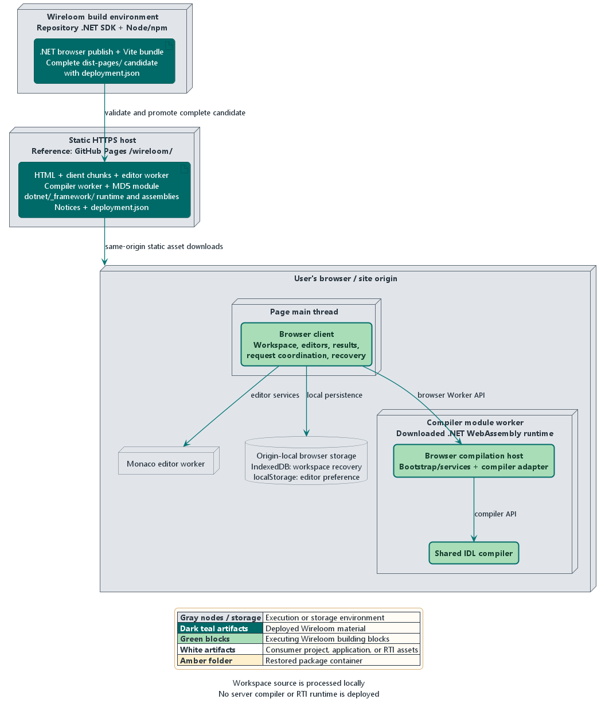

# 7. Deployment view

Wireloom has two deployment scenarios: [.NET build integration](#71-net-build-integration)
for consumer projects and the [browser Playground](#72-browser-playground-deployment).
This chapter maps the [building blocks](05-building-block-view.md) to their
execution environments and identifies where configuration is supplied.
Collaboration and recovery flows are described in [chapter 6](06-runtime-view.md).

## 7.1 .NET build integration

The reference environment is a consumer developer workstation or CI build
agent using the published `Wireloom.Dds.Generator` NuGet package.
The same package supplies the MSBuild integration, Roslyn adapter, and
shared IDL compiler.

### 7.1.1 Artifact placement and execution

| Environment                      | Deployed material                                                                                                  | Building-block mapping and responsibility                                                                  |
| :------------------------------- | :----------------------------------------------------------------------------------------------------------------- | :--------------------------------------------------------------------------------------------------------- |
| NuGet feed                       | Published `Wireloom.Dds.Generator` package                                                                         | Distributes the versioned build integration and bundled compiler                                           |
| Consumer package cache           | `build/Wireloom.Dds.Generator.targets`; generator/compiler DLLs and XML documentation under `analyzers/dotnet/cs/` | Supplies MSBuild integration and the assemblies loaded by Roslyn                                           |
| Developer or CI build host       | Consumer project, IDL inputs, compatible .NET SDK/compiler host, restored package and explicit RTI reference       | Runs .NET build integration and the shared IDL compiler; compiles generated documents into the application |
| Consumer application environment | Compiled application and its selected RTI managed/native runtime assets                                            | Runs the consumer application; RTI owns DDS communication and serialization                                |

The adapter and compiler target `netstandard2.0`. They are loaded together
from the analyzer package and must have matching Wireloom versions.
The compiler is non-packable and has no separate public package.
Package placement is defined in the
[generator project](../../../src/Wireloom.Dds.Generator/Wireloom.Dds.Generator.csproj).

The consumer build must meet the
[framework, language, compiler-host, and RTI constraints](02-architecture-constraints.md#21-product-and-execution-boundaries).
Exact-release qualification and its limits are defined by the
[support policy](../../guides/support-and-compatibility.md#rti-version-qualification).
The consumer does not build Wireloom's source projects or inherit its repository
SDK selection.

Wireloom's assemblies are build-time assets and add no application runtime
dependency. Generated C# is compiled into the application. The application team
owns the resulting deployment, RTI runtime selection, native prerequisites,
and runtime licensing. No external IDL generator or RTI license secret is
required for Wireloom generation; live DDS operation has separate runtime
requirements.

### 7.1.2 Consumer configuration

The .NET DDS application developer or Build and CI engineer owns these settings in
the consuming project and its shared build configuration.

| Configuration                                                                  | Location                                                                                        | Deployment or build impact                                                                                                      | Reference                                                                                                                                  |
| :----------------------------------------------------------------------------- | :---------------------------------------------------------------------------------------------- | :------------------------------------------------------------------------------------------------------------------------------ | :----------------------------------------------------------------------------------------------------------------------------------------- |
| Wireloom package version and feed                                              | Consumer `PackageReference`, central package management if used, and NuGet source configuration | Selects the adapter/compiler pair restored onto each build host; package usage sets `PrivateAssets="all"`                       | [Package usage](../../../src/Wireloom.Dds.Generator/README.md)                                                                             |
| .NET SDK/compiler and IDE host selection                                       | Installed/selected consumer build or IDE tooling; consumer repository `global.json` when used   | Determines which MSBuild/Roslyn host loads the analyzer; target framework alone does not select this host                       | [Host requirements](02-architecture-constraints.md#21-product-and-execution-boundaries)                                                    |
| Consumer framework, C# language, and RTI reference                             | Consumer project or shared MSBuild files                                                        | Sets the application target and emitted-code language requirements; resolved RTI reference selects the generation profile       | [Framework, language, and runtime](../../guides/configuration.md#select-the-consumer-framework-language-and-rti-runtime)                   |
| Generation roots and include search                                            | `DdsIdl`/`AdditionalFiles` items, include-directory properties and root metadata                | Determines which inputs are tracked and made available to generation                                                            | [Roots and includes](../../guides/configuration.md#select-generation-roots-and-included-files)                                             |
| Preprocessing, strictness, identifier escaping, mappings, and effective limits | Project properties and input metadata                                                           | Changes generated contracts at build time; these settings are compiled into output rather than read by the deployed application | [Settings reference](../../guides/configuration.md#settings-at-a-glance)                                                                   |
| Diagnostic policy and generated-source inspection                              | Consumer project/shared build files and analyzer configuration                                  | Controls build acceptance and optional generated-file output                                                                    | [Diagnostics](../../guides/configuration.md#control-diagnostics), [generated files](../../guides/configuration.md#inspect-generated-files) |

These are declarative .NET project settings. Normal restore and build load the
package integration without generation-specific environment variables, tool
paths, or custom invocation scripts. Defaults, precedence, per-file scope, and
examples remain in the [configuration guide](../../guides/configuration.md).

### 7.1.3 Package production and distribution

Wireloom maintainers build and package the product with the repository's
[SDK selection](../../../global.json),
[build defaults](../../../Directory.Build.props), and
[central dependencies](../../../Directory.Packages.props).
These settings belong to the producer environment.

The [preview workflow](../../../.github/workflows/publish-preview.yml)
publishes to GitHub Packages. The
[release workflow](../../../.github/workflows/publish-release.yml)
publishes validated release tags to NuGet.org with SBOM and provenance
attestations. Consumer builds restore these packages; publication is a
maintainer responsibility.

## 7.2 Browser Playground deployment

The reference public deployment is GitHub Pages under `/wireloom/`.
Wireloom publishes a complete static application; compilation runs in the
visitor's browser.

### 7.2.1 Artifact placement and execution

| Environment                    | Deployed material                                                                                                  | Building-block mapping and responsibility                                                         |
| :----------------------------- | :----------------------------------------------------------------------------------------------------------------- | :------------------------------------------------------------------------------------------------ |
| Wireloom build environment     | Repository .NET SDK, pinned Node/npm toolchain, browser project, and Vite build                                    | Publishes the browser compiler and assembles the static candidate                                 |
| Same-origin static HTTPS host  | HTML, client chunks, Monaco worker, notices, compiler worker/MD5 modules, and complete `dotnet/_framework/` assets | Serves one matching version of the complete application; GitHub Pages is the selected public host |
| Browser page                   | TypeScript client and Monaco editor                                                                                | Runs the browser client, workspace interaction, result presentation, and recovery coordination    |
| Browser compiler module worker | Worker bootstrap/services, downloaded .NET WebAssembly runtime, browser compiler adapter, and shared compiler      | Runs the browser compilation host and shared IDL compiler away from the page's main thread        |
| Monaco editor worker           | Bundled editor worker                                                                                              | Supplies editor services in a separate worker                                                     |
| Browser origin storage         | IndexedDB workspace records and localStorage editor preferences                                                    | Keeps recovery data and preferences local to the browser origin                                   |

The [browser project](../../../src/Wireloom.Playground.Browser/Wireloom.Playground.Browser.csproj)
publishes for `browser-wasm` with its selected .NET runtime. The
[build scripts](../../../playground/package.json) copy the published runtime,
compiler worker, and MD5 module into the static bundle.
The visitor downloads the runtime assets and needs no installed .NET SDK,
Node toolchain, RTI runtime, or RTI license. There is no server compiler;
workspace source is processed locally.

Serve the complete matching asset tree. Replacing individual client, worker,
or runtime files independently is unsupported. Host and browser must support
module workers and the required JavaScript/WebAssembly MIME types.
Browser qualification and its limits remain in the
[qualification guide](../../testing/playground-qualification.md).

### 7.2.2 Hosting and browser configuration

Wireloom maintainers own bundle/publication settings. Hosting administrators
own the site configuration; Playground users control their workspace and
browser-local data.

| Configuration                                                  | Location                                                                                                          | Deployment or runtime impact                                                                              | Reference                                                                                                         |
| :------------------------------------------------------------- | :---------------------------------------------------------------------------------------------------------------- | :-------------------------------------------------------------------------------------------------------- | :---------------------------------------------------------------------------------------------------------------- |
| Ordinary bundle base path: `VITE_BASE_PATH` (default `/`)      | Build environment read by `vite.config.ts`                                                                        | Builds asset and worker URLs for local or alternative static hosting                                      | [Vite configuration](../../../playground/vite.config.ts), [Playground build guide](../../../playground/README.md) |
| Pages base path: `PLAYGROUND_BASE_PATH` (default `/wireloom/`) | Repository variable passed to the Pages candidate build                                                           | Produces `dist-pages/` for the intended URL; publisher verifies agreement with the actual Pages URL       | [Repository setup](../../guides/playground-deployment.md#repository-setup)                                        |
| Static host, HTTPS, MIME types, and asset origin               | Static hosting configuration                                                                                      | Makes the complete bundle and workers load from the same origin with correct asset paths                  | [Deployment guide](../../guides/playground-deployment.md)                                                         |
| Pages publication access                                       | GitHub Pages uses Actions; `github-pages` environment restricted to `main`; deployment-job Pages/OIDC permissions | Controls which validated artifact can reach the public site                                               | [Repository setup](../../guides/playground-deployment.md#repository-setup)                                        |
| Recovery and editor preferences                                | Browser-origin IndexedDB/localStorage                                                                             | Persists local data subject to browser storage availability; changing hostname changes the storage origin | [Recovery](../../guides/playground-workspaces.md#results-exports-and-local-recovery)                              |
| IDL workspace settings and selected RTI profile                | Playground workspace UI and exported source workspace                                                             | Configures local compiler requests; these are user inputs rather than host configuration                  | [Workspace settings](../../guides/playground-workspaces.md#compiler-roles-and-settings)                           |

The [base path](12-glossary.md#base-path) is a build-time choice. A changed base path requires a matching
bundle. A hostname change alone can reuse a bundle whose base path still matches
the site. A new hostname creates a different browser storage
[origin](12-glossary.md#origin); existing local recovery data does not move automatically.
See the [custom-domain procedure](../../guides/playground-deployment.md#custom-domain-later).

### 7.2.3 Publication and rollback

The Quality workflow builds and validates a separate `dist-pages/` candidate.
Its `deployment.json` identifies the source revision, Wireloom version, base
path, and complete file inventory with hashes. Pull requests retain a candidate
without publishing a website.

The [publication workflow](../../../.github/workflows/publish-playground.yml)
accepts eligible successful Quality runs from this repository's `main`,
checks the required quality gates, provenance, base path, and artifact hashes,
and promotes the existing bytes without rebuilding. Automatic publication
rejects superseded revisions; deployment is serialized. Only the deployment
job receives Pages write and OIDC permissions.

After publication, checks against the actual HTTPS URL verify the deployed
assets and representative browser operations. A failure requires inspection or
manual rollback; it does not trigger automatic rollback.
A manual `quality_run_id` selects a retained eligible candidate through the
same validation and publication controls. The artifact manifest identifies the
candidate's source revision, including after rollback.

The [deployment runbook](../../guides/playground-deployment.md) owns setup,
local/public verification commands, artifact retention, and
[rollback procedures](../../guides/playground-deployment.md#rollback).
[Chapter 10](10-quality-requirements.md) defines acceptance criteria;
[browser qualification](../../testing/playground-qualification.md) retains measured
results, and [chapter 11](11-risks-and-technical-debt.md#r-08) records remaining deployment exposure.

Supporting test and DDS qualification infrastructure is documented in the
[contribution guide](../../../CONTRIBUTING.md) and
[wire runbook](../../../tests/Wireloom.Dds.Generator.WireCompatibility/README.md).
Its execution flows are in [chapter 6](06-runtime-view.md#63-supporting-verification).

---

[< 6. Runtime view](06-runtime-view.md) | [Index](index.md) | [8. Cross-cutting concepts >](08-crosscutting-concepts.md)
