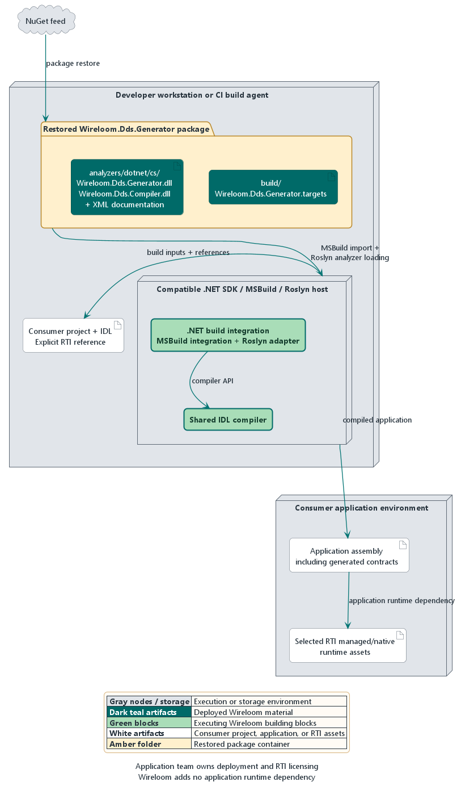

# 7. Deployment view

Wireloom is deployed as a NuGet analyzer/source-generator package rather than
as a service. The generated application still deploys with the consumer's
selected RTI Connext DDS runtime.

## 7.1 Infrastructure level 1

| Node                       | Deployed material                                                 | Role                                                                    |
| :------------------------- | :---------------------------------------------------------------- | :---------------------------------------------------------------------- |
| Developer or CI build host | .NET 10 SDK, consumer project, IDL, Wireloom package              | Runs restore, compilation, generation, and tests                        |
| NuGet feed                 | `Wireloom.Dds.Generator` package and dependencies                 | Supplies the analyzer and MSBuild targets                               |
| Consumer output            | Application assembly plus generated source compiled into it       | Runs the DDS application                                                |
| RTI runtime environment    | Application-selected `Rti.ConnextDds` libraries                   | Owns DDS communication and serialization                                |
| Evidence repository        | Corpus IDL, retained oracle sources, and wire-compatibility peers | Supports source-shape and DDS wire verification, not production runtime |

The manually triggered wire-compatibility workflow currently retains the exact
`rticom/connext-base:7.7.0` evidence run. A separate 7.3.1 run uses its matching
RTI container, NuGet package, and `rtiddsgen` toolchain. RTI license access is
limited to peer-execution jobs; report assembly runs without that secret. The
[wire compatibility runbook](../../../tests/Wireloom.Dds.Generator.WireCompatibility/README.md#case-shards-and-combined-reports)
owns shard execution, image/cache handling, artifact contents, and report
assembly details.
Adding another LTS release requires a profile-specific corpus export and an
exact toolchain image, package, and generator version. Profile selection uses
the assembly resolved by the consumer build.

Preview publication uses GitHub Packages. Validated release tags publish to
NuGet.org with SBOM and provenance attestations.
