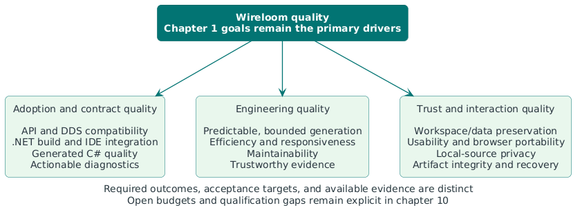

# 10. Quality requirements

This chapter defines observable quality outcomes and the evidence needed to
assess them. Scenarios distinguish required behavior, current validation, and
known gaps; unverified or unmet requirements remain explicit.

## 10.1 Quality tree

The five [chapter 1 priorities](01-introduction-and-goals.md#12-quality-goals)
remain the primary product drivers. Additional qualities make those outcomes
safe, predictable, usable, and maintainable. The .NET adoption goals take
priority over supporting Playground features. Local-source privacy and
protection of user edits remain required.

| Primary driver from chapter 1 | Main scenarios                                                                                                                                                                                                                        |
| :---------------------------- | :------------------------------------------------------------------------------------------------------------------------------------------------------------------------------------------------------------------------------------ |
| 1. Drop-in compatibility      | [Q01](#q01-adopt-generated-application-contracts), [Q08](#q08-exchange-dds-data-with-qualified-peers), [Q09](#q09-keep-effective-configuration-coherent), [Q16](#q16-preserve-generated-value-and-native-resource-behavior)           |
| 2. Build integration          | [Q03](#q03-build-in-a-clean-supported-environment), [Q07](#q07-regenerate-from-the-right-inputs), [Q19](#q19-use-generated-apis-interactively), [Q22](#q22-keep-development-build-cost-proportionate)                                 |
| 3. Generated C# quality       | [Q17](#q17-preserve-handwritten-ownership-through-regeneration), [Q18](#q18-keep-emitted-c-clean-without-shifting-noise-to-consumers), [Q19](#q19-use-generated-apis-interactively)                                                   |
| 4. Actionable diagnostics     | [Q02](#q02-correct-an-idl-problem-from-its-diagnostic), [Q21](#q21-preserve-failure-categories-at-host-boundaries)                                                                                                                    |
| 5. Compiler maintainability   | [Q04](#q04-change-one-responsibility-with-focused-feedback), [Q20](#q20-reproduce-and-isolate-a-compilation), [Q21](#q21-preserve-failure-categories-at-host-boundaries), [Q24](#q24-trust-a-compatibility-or-release-evidence-claim) |

The remaining scenarios cover processing safety, local evaluation, data
preservation, usability/portability, privacy, and release integrity.

## 10.2 Quality scenarios

Each scenario identifies a stakeholder/context, a stimulus, the required
response and acceptance measure, and validation/gaps. Acceptance measures
include observable pass/fail properties, such as zero overwritten edits or
exact document parity. Numerical budgets are identified where agreed or open.

Required interactive environments are **VS Code with documented C# tooling**
and **Visual Studio 2026**, plus **desktop Chrome, Edge, and Firefox** for the
Playground. Exact tested tool, extension, SDK, browser, and OS versions belong
in qualification evidence. Basic keyboard/focus/label/error accessibility is
required; formal conformance remains unselected.

Evidence links point to maintained contracts, procedures, or dated reports.
A scoped report supports only its recorded inputs, versions, and assertions.
Commands, case inventories, execution topology, and detailed runtime behavior
remain in their [guides](../../../CONTRIBUTING.md#quality-evidence),
[deployment view](07-deployment-view.md), [runtime view](06-runtime-view.md),
and [concepts](08-crosscutting-concepts.md).

### 10.2.1 Compatibility and semantic correctness

#### Q01: Adopt generated application contracts

- **Stakeholder / context:** .NET DDS application developer; a consumer using supported IDL, a declared mapping, and a
  supported RTI profile.
- **Stimulus:** Replace RTI C# generation with the packaged Wireloom generator.
- **Response / acceptance:** Existing supported application call sites compile without edits. Document intentional
  developer-experience differences and qualify behavior separately; source resemblance alone is insufficient.
- **Validation / gaps:** [Compatibility policy](09-architectural-decisions.md#921-compatibility-policy-evolution),
  [migration contracts](../../migration/rtiddsgen-to-wireloom.md#generated-c-api-differences), and
  [runtime contracts](../../../tests/Wireloom.Dds.Generator.RuntimeContracts/README.md).
  Adoption exposure is recorded in [R01](11-risks-and-technical-debt.md#r01);
  the [support policy](../../guides/support-and-compatibility.md#rti-version-qualification) defines the unbounded qualification envelope.

#### Q16: Preserve generated value and native resource behavior

- **Stakeholder / context:** .NET DDS application developer; covered generated values and their selected RTI runtime.
- **Stimulus:** Construct, copy, mutate, convert, reuse, or destroy values containing aliases, collections, optionals,
  or unions.
- **Response / acceptance:** Defaults, active branches, optional presence, reference retention versus copying, and
  allocation/cleanup modes match their documented contracts. No covered ownership or lifecycle regression is acceptable.
- **Validation / gaps:**
  [Value/resource concept](08-crosscutting-concepts.md#84-generated-values-and-resource-ownership) and
  [runtime coverage matrix](../../../tests/Wireloom.Dds.Generator.RuntimeContracts/README.md#coverage-matrix). Managed
  behavior, native conversion, and DDS behavior have separate evidence and gaps;
  [R02](11-risks-and-technical-debt.md#r02) records the known enum-array default mismatch.

#### Q08: Exchange DDS data with qualified peers

- **Stakeholder / context:** .NET DDS application developer; an explicitly planned writer/reader combination on an exact
  RTI release and representation.
- **Stimulus:** Publish representative samples, including the declared boundary/default/presence cases, to the
  corresponding reader.
- **Response / acceptance:** Every exchange claimed as passing verifies the expected complete sample. Every applicable
  planned exchange has exactly one attributable result. Unsupported peer shapes, adaptations, failures, and unrun
  exchanges remain visible; no universal nine-pair claim is implied.
- **Validation / gaps:** [Evidence scope](08-crosscutting-concepts.md#85-compatibility-and-evidence),
  [qualification flow](06-runtime-view.md#632-qualify-dds-exchanges-and-retained-reports), and
  [wire runbook](../../../tests/Wireloom.Dds.Generator.WireCompatibility/README.md). Existing profile/peer gaps remain
  in [R01](11-risks-and-technical-debt.md#r01); licensed qualification continuity is
  covered by [R03](11-risks-and-technical-debt.md#r03).

#### Q09: Keep effective configuration coherent

- **Stakeholder / context:** .NET DDS application developer or Wireloom maintainer; multiple roots/includes compiled through
  supported hosts.
- **Stimulus:** Change a root, declaring-file setting, mapping, identifier-normalization policy, or selected
  runtime/profile.
- **Response / acceptance:** The same effective IDL contract produces consistent managed/native metadata across hosts.
  Batch settings remain batch-owned, file settings remain declaring-file-owned, and explicit IDL declarations retain
  their specified precedence. Invalid combinations cannot silently yield an apparently valid alternate contract.
- **Validation / gaps:** [IDL meaning](08-crosscutting-concepts.md#81-idl-meaning-and-identity),
  [configuration reference](../../guides/configuration.md), and packed/runtime contract checks. Mapping, finite-size,
  and escaped-name cases are validation examples, not separate quality goals.

#### Q14: Keep browser and native compiler behavior aligned

- **Stakeholder / context:** Playground user and Wireloom maintainer; identical supplied source/settings/profile within the
  supported browser boundary.
- **Stimulus:** Compile a workspace through the browser adapter and a non-browser .NET shared-compiler caller.
- **Response / acceptance:** Generated document identities/text and compiler diagnostic IDs, severities, messages, and
  source locations match for the compared scope. Host-specific failures remain distinguishable from compiler findings;
  preview success does not claim RTI compilation or wire interoperability.
- **Validation / gaps:** [Shared compilation](06-runtime-view.md#64-c1-compile-an-in-memory-idl-batch),
  [workspace contract](../../guides/playground-workspaces.md#worker-contract-v4), and
  [browser qualification](../../testing/playground-qualification.md). Corpus counts are evidence inventory, not
  permanent acceptance targets.

### 10.2.2 .NET workflow and generated C# quality

#### Q03: Build in a clean supported environment

- **Stakeholder / context:** .NET DDS application developer or Build and CI engineer; a clean supported developer/CI
  host with the consumer's explicit RTI reference.
- **Stimulus:** Restore the published analyzer package and build an IDL-consuming project.
- **Response / acceptance:** MSBuild integration and both analyzer assemblies load; generated contracts compile without
  Wireloom project references, external IDL-generator installation, generation-specific environment wiring, or custom
  generation scripts. Generation needs no RTI license secret.
- **Validation / gaps:** [Consumer deployment](07-deployment-view.md#71-net-build-integration),
  [package verification](../../guides/support-and-compatibility.md#continuous-lts-verification), and
  [released sample](../../../samples/HelloWorld/README.md). Compiler-host eligibility and application target framework
  are checked separately.

#### Q07: Regenerate from the right inputs

- **Stakeholder / context:** .NET DDS application developer; repeated builds or IDE edits in a project with roots,
  includes, options, and runtime references.
- **Stimulus:** Change a relevant input, repeat unchanged input, or edit an unrelated non-IDL input.
- **Response / acceptance:** Relevant changes reach generation and cannot leave obsolete contracts accepted as current.
  Unchanged/unrelated inputs preserve documented reuse. Invalidation assertions must reflect the actual batch boundary;
  per-root output caching is not promised.
- **Validation / gaps:** [Predictable compilation](08-crosscutting-concepts.md#83-predictable-compilation) and
  [incremental baseline](../../performance/incremental-generator-baseline.md). Current source-output invalidation is
  batch-wide; elapsed baseline values are observations, not performance limits.

#### Q17: Preserve handwritten ownership through regeneration

- **Stakeholder / context:** .NET DDS application developer; generated contracts extended through supported partial
  declarations.
- **Stimulus:** Regenerate contracts after an IDL edit while maintaining handwritten extensions.
- **Response / acceptance:** No generated-source export or check-in is required for an ordinary build. Handwritten files
  remain untouched and compile with the regenerated partial types; generated documents remain inspectable through
  supported tooling.
- **Validation / gaps:**
  [Generated-code strategy](04-solution-strategy.md#45-generate-c-that-improves-the-developer-experience),
  [package/generated-file reference](../../guides/configuration.md#inspect-generated-files), and package/compiler
  checks. IDE inspectability is additionally qualified under
  [Q19](#q19-use-generated-apis-interactively).

#### Q18: Keep emitted C# clean without shifting noise to consumers

- **Stakeholder / context:** .NET DDS application developer and Wireloom maintainer; named compiler/analyzer configurations
  applied to consumer code and independently staged emitted code.
- **Stimulus:** Compile and analyze generated contracts, including a regeneration.
- **Response / acceptance:** Normal tooling recognizes generated ownership and produces no preventable generated-code
  noise under the qualified consumer analysis configuration. Independent emitted-source analysis has zero preventable
  compiler/analyzer findings under its declared rules, with intentional exclusions recorded. Excluding generated code is
  not proof of intrinsic code quality.
- **Validation / gaps:**
  [Analysis strategy](04-solution-strategy.md#46-verify-different-contracts-with-separate-test-layers) and
  [generated-C# report](../../corpus/csharp-quality.md). That report has scoped exclusions/configuration differences.
  Consumer Qodana and SonarQube behavior need named-tool/version evidence; an all-analyzers zero-warning guarantee is
  not established; see [R05](11-risks-and-technical-debt.md#r05) for mitigation.

#### Q19: Use generated APIs interactively

- **Stakeholder / context:** .NET DDS application developer; VS Code with documented C# tooling, or Visual Studio 2026,
  using a supported consumer SDK/profile.
- **Stimulus:** Open/build a contract project, edit IDL, inspect generated symbols/XML documentation, and navigate a
  reported IDL error.
- **Response / acceptance:** For the qualified IDE configuration, current generated types and member documentation are
  discoverable, handwritten use sites receive current C# IntelliSense, and diagnostics navigate to the correct original
  input. Representative documented API operations compile as shown. No IDL semantic language server is implied.
- **Validation / gaps:** [Build strategy](04-solution-strategy.md#41-integrate-generation-into-the-net-compiler) and
  [generated-value guide](../../guides/generated-value-semantics.md). Interactive IDE qualification is incomplete.
  Record IDE, extensions, selected SDK, RTI version, operations, and results; command-line compilation alone does not
  meet this scenario. [R04](11-risks-and-technical-debt.md#r04) records mitigation and
  next actions; refresh-latency budgets remain open.

### 10.2.3 Diagnostics, predictability, and processing safety

#### Q02: Correct an IDL problem from its diagnostic

- **Stakeholder / context:** .NET DDS application developer or Playground user; invalid, unsupported, ignored, or
  potentially lossy IDL reaches a host.
- **Stimulus:** Compile that input, including cases transformed by macros/includes/normalization.
- **Response / acceptance:** A stable finding identifies the original input and UTF-16 position, describes the problem,
  and distinguishes rejection from accepted warnings/information. Unsafe output is withheld. A representative developer
  can locate and correct the input using the diagnostic/reference without inspecting generated implementation code.
- **Validation / gaps:**
  [Failure-reporting concept](08-crosscutting-concepts.md#82-source-provenance-and-failure-reporting),
  [correction flow](06-runtime-view.md#612-diagnose-and-correct-generation-problems), and
  [diagnostic policy](../../guides/configuration.md#control-diagnostics). Strict rejection and warning promotion remain
  distinct; source-location tests do not by themselves prove message comprehensibility.

#### Q06: Bound processing and honor cancellation safely

- **Stakeholder / context:** Build and CI engineer or Wireloom maintainer; adversarial/large inputs or a canceling compiler host.
- **Stimulus:** Reach a documented processing limit or request cancellation during supported compiler work.
- **Response / acceptance:** Deterministic work/output/nesting limits are enforced. Limit failures cannot pass partial
  preprocessing into parsing or expose partial generated success. Cancellation propagates as cancellation, not an IDL
  finding or successful result. Fixed work limits do not imply a hard process-memory quota.
- **Validation / gaps:** [Safety concept](08-crosscutting-concepts.md#83-predictable-compilation),
  [published limits](../../guides/configuration.md#fixed-behavior-and-configurable-limits), and compiler
  boundary/adversarial checks. Cancellation-latency and peak-memory budgets remain open. Sample-value unbounded support
  is independent of these limits; [R09](11-risks-and-technical-debt.md#r09) records resource exposure.

#### Q20: Reproduce and isolate a compilation

- **Stakeholder / context:** Wireloom maintainer; supplied inputs/options/profile and a conforming deterministic
  platform-service provider.
- **Stimulus:** Repeat compilation, use another host, mutate caller-owned option collections after input creation, or
  interleave independent calls.
- **Response / acceptance:** Equivalent effective inputs produce the expected stable ordered documents/diagnostics
  without cross-call semantic leakage. Input snapshots remain insulated from later mutations. Distinct preprocessing
  states remain meaningful; duplicate hint names fail rather than overwrite a document.
- **Validation / gaps:** [Predictability concept](08-crosscutting-concepts.md#83-predictable-compilation),
  [compiler contract](05-building-block-view.md#compiler-contract-and-payload-examples), and focused compiler
  boundary/order/provider tests. Provider determinism/concurrency safety remains a caller obligation.

#### Q21: Preserve failure categories at host boundaries

- **Stakeholder / context:** Wireloom maintainer; invalid caller arguments, provider failures, implementation defects,
  and cancellation.
- **Stimulus:** Invoke compilation with one of those failures rather than ordinary invalid IDL.
- **Response / acceptance:** Caller/implementation faults and cancellation follow their documented exception contracts.
  No such fault becomes a misleading ordinary IDL rejection or apparently successful generated result. Host presentation
  preserves the distinction while keeping current source available.
- **Validation / gaps:** [Failure categories](08-crosscutting-concepts.md#82-source-provenance-and-failure-reporting),
  [MD5 contract](../adr/ADR-002-inject-member-id-md5-per-compilation.md), and compiler/adapter boundary tests. Browser
  host recovery is separately covered by [Q27](#q27-recover-compilation-after-a-browser-host-failure).

### 10.2.4 Maintainability and confidence in change

#### Q04: Change one responsibility with focused feedback

- **Stakeholder / context:** Wireloom maintainer; a compiler, integration, or adapter change within the documented
  boundaries.
- **Stimulus:** Add or correct supported behavior.
- **Response / acceptance:** Focused assertions exercise the changed behavior without requiring the full corpus for the
  first feedback. Applicable wider package/runtime/corpus/wire evidence and architecture/contracts are updated before
  the corresponding claim is complete. Existing maintained-compiler gates require at least 90% branch and 95% line
  coverage; percentages do not substitute for behavioral assertions.
- **Validation / gaps:** [Building blocks](05-building-block-view.md),
  [maintenance choices](09-architectural-decisions.md), and
  [quality workflow](../../../CONTRIBUTING.md#quality-evidence). Required Qodana/CI/Coveralls checks remain repository
  gates. Test counts, time-to-fix, and modification-size budgets are not established quality guarantees.

#### Q24: Trust a compatibility or release evidence claim

- **Stakeholder / context:** Wireloom maintainer; named cases, profiles, peer scopes, revisions, tools, and partitioned
  reports.
- **Stimulus:** Produce, combine, or review evidence, including missing/duplicate/misassigned/unattributed results.
- **Response / acceptance:** A completed claim is attributable to its exact scope. Missing or inconsistent required
  evidence prevents a complete/passing qualification claim. Report integrity and exchange success remain separately
  visible; complete reports can contain failing exchanges. Historical missing provenance remains unknown.
- **Validation / gaps:** [Evidence concept](08-crosscutting-concepts.md#85-compatibility-and-evidence),
  [LTS provenance](../../corpus/LTS-PROFILES.md), and
  [Verifier/report contracts](../../../tests/Wireloom.Dds.Generator.WireCompatibility/README.md#read-the-results).
  Unresolved findings remain gaps rather than completed coverage; licensed evidence continuity is
  assessed in [R03](11-risks-and-technical-debt.md#r03).

### 10.2.5 Efficiency and responsiveness

#### Q22: Keep development build cost proportionate

- **Stakeholder / context:** .NET DDS application developer or Build and CI engineer; a declared representative contract
  workload on a recorded supported host.
- **Stimulus:** Perform cold generation, unchanged reruns, IDL/include edits, and unrelated edits.
- **Response / acceptance:** Measure generator elapsed time, output volume, and reuse separately from
  restore/network/whole-build costs. Relevant edits update contracts and unrelated inputs retain documented reuse.
  Absolute time, regression, memory, and package-footprint budgets remain open; historical timings are not an agreed
  ceiling.
- **Validation / gaps:** [Incremental baseline](../../performance/incremental-generator-baseline.md),
  [invalidation concept](08-crosscutting-concepts.md#83-predictable-compilation), and
  [build integration](07-deployment-view.md#71-net-build-integration). Refresh the representative workload/host
  baseline before proposing numerical acceptance budgets under
  [O01](11-risks-and-technical-debt.md#o01). Current batch invalidation is recorded in
  [D02](11-risks-and-technical-debt.md#d02).

#### Q23: Keep Playground interaction responsive

- **Stakeholder / context:** Playground user; a recorded desktop browser/workload during cold startup, ordinary edits,
  and sustained compilation.
- **Stimulus:** Load the published bundle or edit while representative compiler work is running.
- **Response / acceptance:** Editing remains available and current source is preserved. Intermediate requests do not
  form an unbounded queue: retain at most the active request and newest unsubmitted snapshot. Measure cold/warm
  readiness, edit-task latency, and edit-to-current-result latency separately. General startup/latency/download/memory
  budgets remain open.
- **Validation / gaps:** [Worker choice](../adr/ADR-003-run-playground-compilation-in-a-browser-worker.md),
  [preview flow](06-runtime-view.md#621-preview-the-current-workspace), and
  [qualification measurements](../../testing/playground-qualification.md#interaction-and-failure-checks). The existing
  representative edit-task check uses 250 ms and must be shorter than compilation; that scoped test criterion is not a
  universal user-experience SLA.

### 10.2.6 Playground reliability and data preservation

#### Q15: Apply workspace edits atomically

- **Stakeholder / context:** Playground user; a valid current virtual workspace with open editor models.
- **Stimulus:** Import, move, rename, change roles/settings, or cancel/reject such a proposed operation.
- **Response / acceptance:** Accepted changes apply coherently; rejected/canceled operations leave the prior
  workspace/result intact. Valid moves preserve file identity and editor undo, paths remain unique/normalized, and
  include source text is not silently rewritten. Test before/after state rather than only the success notice.
- **Validation / gaps:** [Workspace consistency](08-crosscutting-concepts.md#86-workspace-consistency),
  [change flow](06-runtime-view.md#622-change-a-workspace-safely), and
  [workspace qualification](../../testing/playground-qualification.md#workspace-boundary). Undo preservation concerns
  editing operations, not an unpromised persisted undo history across reload.

#### Q25: Present and export only current generated output

- **Stakeholder / context:** Playground user; asynchronous compilation with edits, option/profile changes, or replaced
  workers.
- **Stimulus:** Receive a success/failure response for an older snapshot or request an export while a result is
  pending/failed.
- **Response / acceptance:** Only matching request/worker/workspace/profile identity can establish current output.
  Obsolete results and failures cannot replace current state. Pending/outdated/failed generated output cannot be
  exported; current successful documents retain exact text. Source backup remains independently available, including
  invalid/rootless/empty input.
- **Validation / gaps:** [Freshness concept](08-crosscutting-concepts.md#86-workspace-consistency),
  [preview](06-runtime-view.md#621-preview-the-current-workspace),
  [export flow](06-runtime-view.md#623-export-source-or-current-generated-output), and browser identity/export checks.

#### Q26: Recover saved work without losing newer edits

- **Stakeholder / context:** Playground user; a last successfully saved workspace, with browser storage either available
  or failing.
- **Stimulus:** Reload, finish a delayed restore, reset during queued saves, or encounter invalid/unsupported persisted
  data.
- **Response / acceptance:** When a valid saved record can be applied, restore its source, paths/folders, roles,
  profile, and settings. Late restore cannot overwrite newer edits; after successful reset deletion, queued/obsolete
  saves cannot resurrect old data. Save completion cannot mislabel newer edits. Invalid/unavailable recovery is reported
  while editing remains usable. Regenerate output from recovered source.
- **Validation / gaps:** [Recovery concept](08-crosscutting-concepts.md#86-workspace-consistency),
  [restore/reset flow](06-runtime-view.md#624-restore-or-reset-the-local-workspace), and recovery model/browser checks.
  Browser storage is fallible: recovery covers valid saved records and does not guarantee unsaved changes or
  unlimited retention. [R07](11-risks-and-technical-debt.md#r07) records mitigations.

#### Q27: Recover compilation after a browser-host failure

- **Stakeholder / context:** Playground user; retained workspace source and an eligible compiler request.
- **Stimulus:** Encounter startup/worker/provider/request failure or a compilation watchdog timeout, then recover after
  the cause is removed.
- **Response / acceptance:** Current failure is explicit, unsafe/stale generated export stays disabled, and source
  editing/backup survives. A compilation timeout starts replacement; startup/uncaught faults expose Retry, and request
  failure can retain a ready worker. Retry can compile the current eligible workspace; failed in-flight work
  is not automatically replayed.
- **Validation / gaps:** [Host recovery flow](06-runtime-view.md#625-recover-browser-compilation-after-a-host-failure),
  [worker contract](../../guides/playground-workspaces.md#worker-contract-v4), and injected-fault checks. Watchdog
  settings are failure-detection mechanisms, not accepted startup/response-time budgets.

### 10.2.7 Browser usability and portability

#### Q28: Use the supported desktop browsers

- **Stakeholder / context:** Playground user; desktop Chrome, Edge, or Firefox on an explicitly qualified OS/version
  combination.
- **Stimulus:** Perform the declared core workspace, generation, diagnostics, export, and recovery tasks.
- **Response / acceptance:** Each required browser family must have a recorded qualification result for the released
  bundle and tested version/OS. Required behavior remains consistent; limitations are explicit. WebKit evidence is
  supplementary and does not establish Safari support. Mobile and Safari are outside the present promised scope.
- **Validation / gaps:** [Playground deployment](07-deployment-view.md#72-browser-playground-deployment),
  [browser qualification scope](../../testing/playground-qualification.md#evidence-boundaries), and
  [Q29](#q29-complete-core-tasks-with-accessible-interaction). Existing
  engine/scoped-host runs do not qualify every branded browser, future version, or OS.

#### Q29: Complete core tasks with accessible interaction

- **Stakeholder / context:** Playground user; keyboard-only operation and either supported theme in a qualified desktop
  browser.
- **Stimulus:** Open/edit source, select files/profile/settings, navigate diagnostics, export, and invoke available
  recovery/reset actions.
- **Response / acceptance:** Every declared core task has a keyboard path, focus remains visible and usable, controls
  have understandable labels, and errors have a textual/programmatic cue beyond color. Verify completing tasks and
  returning focus, including dialogs and failure states; syntax coloring alone is not a validity indicator.
- **Validation / gaps:** [Workspace guide](../../guides/playground-workspaces.md) and
  [UI checks](../../testing/playground-qualification.md#interaction-and-failure-checks). These are required
  usability/accessibility behaviors. Existing keyboard checks are partial evidence; no formal WCAG conformance level or
  completed assistive-technology audit is claimed. Qualification exposure and mitigation are in
  [R06](11-risks-and-technical-debt.md#r06).

### 10.2.8 Privacy and trusted delivery

#### Q30: Keep supplied IDL local

- **Stakeholder / context:** Playground user; private IDL supplied through examples, editing, import, diagnostics, and
  local recovery.
- **Stimulus:** Compile, switch profiles, recover/reset, and explicitly export files.
- **Response / acceptance:** No supplied private IDL is sent to a compiler service or carried in outgoing
  URLs/telemetry/network payloads. Runtime/editor resources come from the same-origin static bundle. Explicit
  copy/download exports remain user-controlled. Validate representative network traces and source-handling paths rather
  than infer privacy from worker use alone.
- **Validation / gaps:** [Local-source constraint](02-architecture-constraints.md#21-product-and-execution-boundaries),
  [browser deployment](07-deployment-view.md#72-browser-playground-deployment), and scoped browser request checks. A
  recorded trace is evidence for those exercised flows, not a general privacy certification.

#### Q05: Publish only eligible verifiable artifacts

- **Stakeholder / context:** Build and CI engineer or Wireloom maintainer; package/site publication from trusted and
  untrusted candidate contexts.
- **Stimulus:** Offer a PR, stale source, failed-quality, changed, or otherwise ineligible candidate for publication.
- **Response / acceptance:** Only eligible validated candidates pass the documented release gates. Retain required
  package SBOM/provenance; preserve exact validated Pages candidate bytes and source identity. Reject
  missing/changed/unexpected assets and ineligible automatic revisions. Use scoped publication permissions and exclude
  license/credential material from retained evidence as required by policy.
- **Validation / gaps:**
  [Evidence/security constraints](02-architecture-constraints.md#22-evidence-and-provenance-policies),
  [package distribution](07-deployment-view.md#713-package-production-and-distribution),
  [Pages promotion](07-deployment-view.md#723-publication-and-rollback), and their workflows. A green unrelated build
  or source revision alone is insufficient.

#### Q31: Detect and recover an invalid public deployment

- **Stakeholder / context:** Wireloom maintainer; published Playground assets and an eligible retained candidate.
- **Stimulus:** Deploy incomplete/wrong assets, fail a live behavior/MIME check, or request manual rollback.
- **Response / acceptance:** Verify the served asset inventory/bytes against the candidate and exercise representative
  HTTPS startup/generation/export behavior. A failed check remains unsuccessful and visible. Manual rollback promotes an
  eligible validated retained candidate through the same controls; expired/incompatible candidates need a newly
  validated path.
- **Validation / gaps:** [Publication/rollback](07-deployment-view.md#723-publication-and-rollback) and
  [deployment runbook](../../guides/playground-deployment.md). There is no automatic rollback or agreed public
  availability/recovery-time SLA; retention and procedures belong to the runbook, with operational exposure in
  [R08](11-risks-and-technical-debt.md#r08).

## 10.3 Open numerical targets and qualification work

The requirements above include established qualitative and pass/fail targets.
The following numerical budgets or qualification conclusions are **open**;
current observations do not stand in for stakeholder agreement.

| Topic                           | Required measurement or next qualification                                                                                                                              | Current distinction                                                                                  |
| :------------------------------ | :---------------------------------------------------------------------------------------------------------------------------------------------------------------------- | :--------------------------------------------------------------------------------------------------- |
| Build and IDE latency           | Agree representative IDL workloads, host/SDK/IDE conditions, and cold/warm/edit measurements before selecting absolute and regression budgets                           | The incremental baseline is historical measurement evidence, not a ceiling                           |
| Playground startup and response | Separately measure cold/warm readiness, public-network loading, main-thread edit latency, and edit-to-current-result latency on declared browser/OS/workload conditions | The scoped 250 ms edit-task check and watchdogs are existing checks/mechanisms, not a general SLA    |
| Memory, output, and footprint   | Agree peak-memory/package/download budgets where needed; continue enforcing the published deterministic input/work/output limits                                        | A fixed work cap is not a hard memory quota or evidence of efficient behavior                        |
| Cancellation and recovery time  | Define observable cancellation/retry/recovery budgets on representative inputs and fault conditions                                                                     | Correct classification and preserved source are required now; bounded latency is not yet established |

IDE, consumer-analysis, and browser/accessibility qualification are specified in
[Q19](#q19-use-generated-apis-interactively),
[Q18](#q18-keep-emitted-c-clean-without-shifting-noise-to-consumers), and
[Q28–Q29](#q28-use-the-supported-desktop-browsers). Their risk assessments,
mitigations, and next actions are in [chapter 11](11-risks-and-technical-debt.md#112-active-risks).

The existing direct Node coverage gate and broader combined browser coverage
have different scopes. The qualification guide owns their dated results and
outstanding targets, with the retained UI shortfall tracked in
[D03](11-risks-and-technical-debt.md#d03). Neither proves every scenario above is satisfied.
Likewise, coverage percentages are regression safeguards, not a substitute for
API, user-task, native lifecycle, or interoperability evidence.

Current capability gaps and historical mitigations are recorded in
[chapter 11](11-risks-and-technical-debt.md). The unbounded receive-lifecycle
and fragmentation gap is mitigated in [historical D01](11-risks-and-technical-debt.md#d01);
the [support policy](../../guides/support-and-compatibility.md#rti-version-qualification) defines its qualification envelope.
Detailed current measurements and findings stay in the
[generated-C# report](../../corpus/csharp-quality.md),
[incremental baseline](../../performance/incremental-generator-baseline.md),
[browser qualification](../../testing/playground-qualification.md), and
[runtime contract matrix](../../../tests/Wireloom.Dds.Generator.RuntimeContracts/README.md#coverage-matrix).

---

[< 9. Architectural decisions](09-architectural-decisions.md) | [Index](index.md) | [11. Risks and technical debt >](11-risks-and-technical-debt.md)
